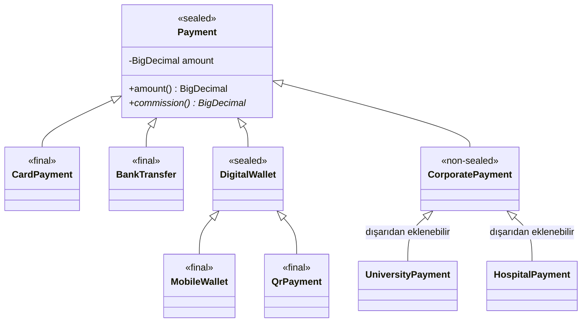
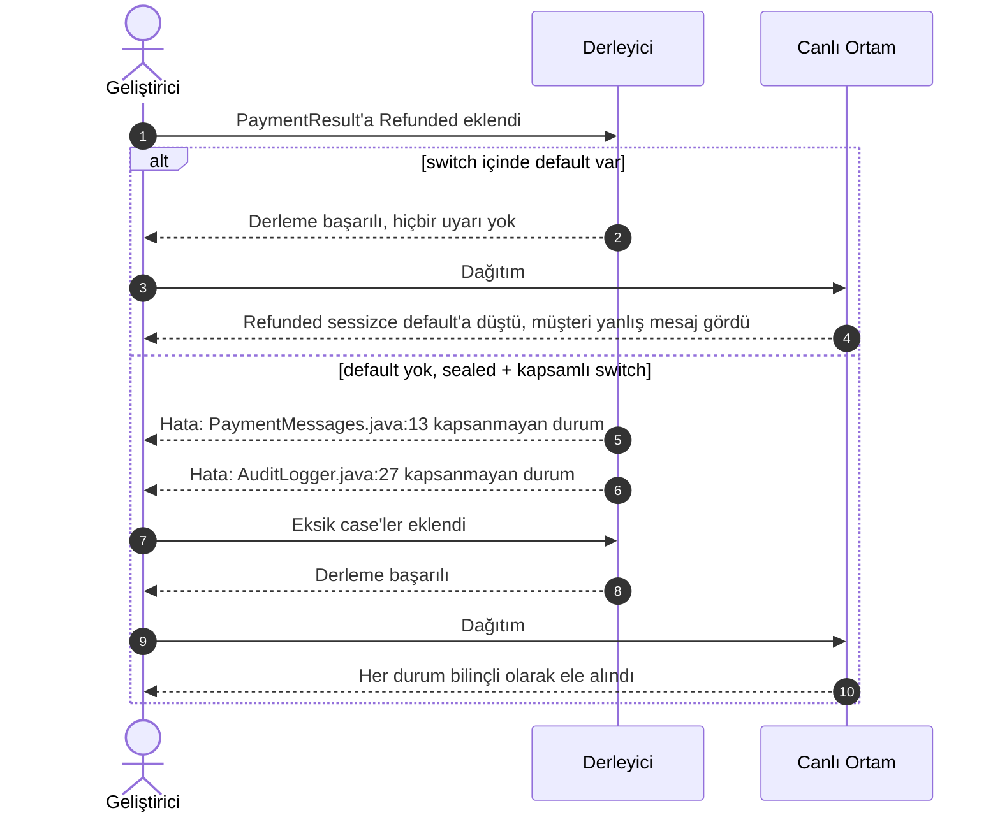
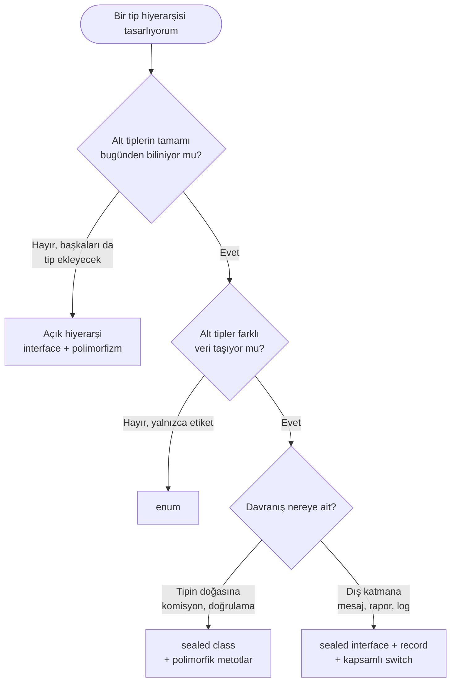

# Java'da Sealed Class'lar: Kalıtıma Davetli Listesi Yazmak

> Bir sınıfı `extends` ile genişletmek, o sınıfın verdiği sözü devralmaktır. Sealed class'lar bize şu soruyu sordurur: Bu sözü kimin devralabileceğine kim karar veriyor?

Java'da uzun yıllar boyunca bir sınıf için yalnızca iki seçeneğimiz vardı. Ya `final` yazıp kapıyı tamamen kilitliyorduk ya da hiçbir şey yazmayıp kapıyı herkese açık bırakıyorduk. Arası yoktu. Oysa gerçek hayattaki modellerin çoğu bu iki ucun arasında bir yerde durur. Bir ödeme ya onaylanır, ya reddedilir ya da beklemede kalır. Dördüncü bir ihtimal yoktur ve olmamalıdır. Ama dil bu bilgiyi ifade etmemize izin vermiyordu. Bildiğimiz şeyi kodun içine yazamıyor, ancak yorum satırlarına ve iyi niyete emanet edebiliyorduk.

Java 17 ile kalıcı hale gelen sealed class'lar bu boşluğu dolduruyor. Kapıyı kilitlemiyor, sonuna kadar da açmıyor; kapıya bir davetli listesi asıyor. Bu yazıda sealed class'ları bir sözdizimi ayrıntısı olarak değil, bir tasarım kararı olarak ele almak istiyorum: Neyi çözüyor, OOP ve SOLID ile nasıl konuşuyor, kodun yıllar içinde sağlıklı kalmasına nasıl katkı veriyor ve nerede kullanılmamalı?

Bütün örnekler tek bir alan üzerinden ilerliyor: bir e-ticaret sisteminin ödeme modülü. Kodların tamamı Java 21 ile derlenip çalıştırıldı.

## İçindekiler

1. [Sorun: Açık Kapının Görünmeyen Bedeli](#1-sorun-açık-kapının-görünmeyen-bedeli)
2. [Sealed Class Nedir?](#2-sealed-class-nedir)
3. [Sealed Interface ve Record: Geçersiz Durumu Temsil Edilemez Kılmak](#3-sealed-interface-ve-record-geçersiz-durumu-temsil-edilemez-kılmak)
4. [Pattern Matching ile Kapsamlı switch](#4-pattern-matching-ile-kapsamlı-switch)
5. [Sürdürülebilirlik: Derleyiciyi Takım Arkadaşı Yapmak](#5-sürdürülebilirlik-derleyiciyi-takım-arkadaşı-yapmak)
6. [SOLID Penceresinden Sealed Class](#6-solid-penceresinden-sealed-class)
7. [Kurallar ve Sınırlar](#7-kurallar-ve-sınırlar)
8. [Enum, Sealed, Açık Hiyerarşi ve Visitor](#8-enum-sealed-açık-hiyerarşi-ve-visitor)
9. [Doğru Aracı Seçmek](#9-doğru-aracı-seçmek)
10. [Temiz Kod İçin Kontrol Listesi](#10-temiz-kod-için-kontrol-listesi)

---

## 1. Sorun: Açık Kapının Görünmeyen Bedeli

Şu kod çoğumuza tanıdık gelecektir:

```java
public abstract class Payment { /* ... */ }

public class CardPayment extends Payment { /* ... */ }
public class BankTransfer extends Payment { /* ... */ }

public class CommissionCalculator {

    public BigDecimal calculate(Payment payment) {
        if (payment instanceof CardPayment card) {
            return card.amount().multiply(CARD_RATE);
        } else if (payment instanceof BankTransfer) {
            return BANK_FIXED_FEE;
        } else {
            throw new IllegalArgumentException("Bilinmeyen ödeme tipi: " + payment.getClass());
        }
    }
}
```

İlk bakışta masum. Ama sondaki `else` bloğu aslında bir itiraftır: "Bu metodun bütün ihtimalleri kapsadığından emin değilim, emin olmamın bir yolu da yok. O yüzden kontrolü çalışma zamanına bırakıyorum."

Altı ay sonra başka bir ekipten biri `DigitalWallet extends Payment` yazdığında kod sorunsuz derlenir. Testler de yeşil kalabilir, çünkü kimsenin aklına yeni tipi bu hesaplayıcıdan geçirmek gelmemiştir. Hata ilk kez canlı ortamda, gerçek bir müşterinin ödemesinde ortaya çıkar.

Buradaki sorun kötü yazılmış bir `if` zinciri değil. Sorun, bizim bildiğimiz bir gerçeği ("ödeme tipleri sınırlı ve bellidir") derleyicinin bilmemesi. Bilgi bizim kafamızda, kod ise bu bilgiden habersiz.

## 2. Sealed Class Nedir?

Sealed bir sınıf ya da interface, kendisini kimlerin genişletebileceğini açıkça beyan eder:

```java
public sealed abstract class Payment
        permits CardPayment, BankTransfer, DigitalWallet, CorporatePayment {

    private final BigDecimal amount;

    protected Payment(BigDecimal amount) {
        this.amount = Objects.requireNonNull(amount, "amount");
    }

    public BigDecimal amount() {
        return amount;
    }

    public abstract BigDecimal commission();
}
```

`permits` listesinde olmayan hiçbir sınıf `Payment`'ı genişletemez. Dahası, listedeki her alt sınıf da kendi kaderini açıkça seçmek zorundadır. Bu seçim üç kelimeyle yapılır:

| Anahtar kelime | Anlamı | Ne zaman tercih ederim? |
|---|---|---|
| `final` | Hiyerarşi burada biter, kimse genişletemez. | Varsayılan tercihim. Alt tipin kendi alt tiplerine ihtiyaç duyması için bir sebep yoksa. |
| `sealed` | Bu sınıf da kendi davetli listesini belirler. | Alt kategoriler varsa ve onlar da sınırlıysa (dijital cüzdan altında mobil cüzdan ve QR ödeme gibi). |
| `non-sealed` | Bu daldan sonrası herkese açık. | Bilinçli olarak bir genişletme noktası bırakmak istediğimde (anlaşmalı kurumların kendi ödeme sınıfları gibi). |

```java
public final class CardPayment extends Payment { /* ... */ }

public final class BankTransfer extends Payment { /* ... */ }

public sealed abstract class DigitalWallet extends Payment
        permits MobileWallet, QrPayment { /* ... */ }

public non-sealed abstract class CorporatePayment extends Payment { /* ... */ }
```

Bir alt sınıfa bu üç kelimeden birini yazmayı unutursak derleyici durur ve `sealed, non-sealed or final modifiers expected` der. Yani Java burada bizi bir karar vermeye zorluyor. Bence özelliğin en değerli yanlarından biri de bu: Kalıtım artık düşünülmeden, varsayılan olarak açık kalan bir şey değil.



*Şekil 1: Ödeme hiyerarşisi. Kapalı dallar `final` ya da `sealed` ile biterken tek açık uç `non-sealed` olarak işaretlenmiş `CorporatePayment`.*

Diyagramdaki tek açık uç `CorporatePayment`. Oradaki `non-sealed` kelimesi aslında şunu söylüyor: "Bu kapıyı unutarak değil, bilerek açık bıraktım." Küçük ama anlamlı bir ayrıntı: `non-sealed`, Java'nın tire içeren ilk anahtar kelimesi. Dilin tasarımcıları bu kararı görünür kılmak için yeni bir sözcük üretmeyi göze almışlar. `sealed` ve `permits` ise bağlamsal anahtar kelimeler; eski bir kodda değişken adı olarak kullanıldılarsa hiçbir şey bozulmuyor.

## 3. Sealed Interface ve Record: Geçersiz Durumu Temsil Edilemez Kılmak

Sealed class'ların asıl gücü record'larla birleştiğinde ortaya çıkıyor. Önce eski usul bir ödeme cevabına bakalım:

```java
public class PaymentResponse {
    private boolean success;
    private boolean pending;
    private String transactionId; // yalnızca başarılıysa dolu
    private String errorCode;     // yalnızca reddedildiyse dolu
    private String referenceNo;   // yalnızca beklemedeyse dolu
    // getter ve setter'lar...
}
```

İki `boolean` ve null olabilen üç alan. Bu sınıf kâğıt üzerinde 2 × 2 × 2 × 2 × 2 = 32 farklı durumu temsil edebilir. İş kuralı açısından anlamlı olan ise yalnızca üç tanesi. Geri kalan 29 durum (hem başarılı hem beklemede olan bir ödeme, işlem numarası olmayan başarılı bir ödeme...) her an oluşabilecek birer hatadır. Bu sınıfı kullanan her geliştirici yorum satırlarını okumak, doğru alanı doğru zamanda kontrol etmek zorundadır. Sınıfın kendisi ise bu konuda hiçbir yardımda bulunmaz.

Aynı modeli sealed interface ve record'larla kuralım:

```java
public sealed interface PaymentResult {

    record Approved(String transactionId, BigDecimal amount) implements PaymentResult {
        public Approved {
            Objects.requireNonNull(transactionId, "transactionId");
            if (amount == null || amount.signum() <= 0) {
                throw new IllegalArgumentException("Onaylanan tutar pozitif olmalı");
            }
        }
    }

    record Declined(DeclineReason reason, String detail) implements PaymentResult {
        public Declined {
            Objects.requireNonNull(reason, "reason");
        }
    }

    record Pending(String referenceNo, Duration estimatedWait) implements PaymentResult {
        public Pending {
            Objects.requireNonNull(referenceNo, "referenceNo");
            Objects.requireNonNull(estimatedWait, "estimatedWait");
        }
    }
}
```

Artık tam olarak üç durum var ve her durum yalnızca kendine ait veriyi taşıyor. Reddedilmiş bir ödemenin işlem numarası olamaz, çünkü öyle bir alan yok. Onaylanmış bir ödemenin tutarı negatif olamaz, çünkü compact constructor buna izin vermiyor. Nesne oluştuğu anda geçerlidir; sonradan "acaba bu alan dolu mu?" diye sormaya gerek kalmaz.

Dikkat çekmek istediğim iki ayrıntı var:

- **`permits` yazmadım.** Alt tipler aynı dosyada tanımlandığında derleyici listeyi kendisi çıkarıyor. Küçük ve birbirine sıkı bağlı durum kümelerinde bu yaklaşım okunurluğu artırıyor; bütün resmi tek ekranda görüyorsunuz.
- **Record'lar örtük olarak `final`.** Bu yüzden ayrıca bir şey yazmaya gerek kalmıyor ve sealed hiyerarşilerin doğal yaprakları oluyorlar.

Fonksiyonel programlama dünyasında bunun adı *cebirsel veri tipidir* (algebraic data type). Record bir "ve" ifadesidir: işlem numarası **ve** tutar. Sealed interface ise bir "veya" ifadesidir: onaylandı **veya** reddedildi **veya** beklemede. Java bu iki kavramı yıllar sonra aynı çatı altında buluşturdu.

## 4. Pattern Matching ile Kapsamlı switch

Sealed tiplerin derleyiciye kazandırdığı bilgi, Java 21 ile kalıcı hale gelen pattern matching for switch sayesinde somut bir faydaya dönüşüyor:

```java
public final class PaymentMessages {

    private PaymentMessages() {
    }

    public static String toCustomerMessage(PaymentResult result) {
        return switch (result) {
            case Approved(var transactionId, var amount) ->
                    "Ödemeniz alındı: %s TL (işlem no: %s)".formatted(amount, transactionId);

            case Declined declined when declined.reason() == DeclineReason.INSUFFICIENT_FUNDS ->
                    "Bakiyeniz yetersiz görünüyor. Farklı bir kartla deneyebilirsiniz.";

            case Declined declined ->
                    "Ödeme onaylanmadı: " + declined.detail();

            case Pending(var referenceNo, var wait) ->
                    "İşleminiz sırada, yaklaşık %d dakika içinde sonuçlanacak (ref: %s)"
                            .formatted(wait.toMinutes(), referenceNo);
        };
    }
}
```

Bu `switch` ifadesinde `default` yok ve olmasına gerek de yok. Derleyici `PaymentResult`'ın yalnızca üç alt tipi olduğunu biliyor ve üçünün de ele alındığını kendisi doğruluyor. Kodda öne çıkan birkaç nokta var:

1. **Record pattern:** `Approved(var transactionId, var amount)` yazarak record'u tek adımda açıyoruz. Getter çağırmaya ya da cast yapmaya gerek kalmıyor.
2. **Guard (`when`):** Aynı tipin özel bir durumunu ayrıca ele alabiliyoruz. Ancak guard'lı bir case o tipi tek başına kapsamış sayılmaz. Arkasından koşulsuz bir `case Declined declined` gelmezse derleyici switch'in eksik olduğunu söyler.
3. **Sıralama önemli:** Özel durum genel durumdan önce yazılmalı. Ters sırada yazarsanız genel case özel olanı gölgeler ve derleyici `this case label is dominated by a preceding case label` hatasını verir.

## 5. Sürdürülebilirlik: Derleyiciyi Takım Arkadaşı Yapmak

Bir kod tabanının sürdürülebilirliğini bence en iyi şu soru ölçer: *Bir şeyi değiştirdiğimde, neyi bozduğumu ne kadar çabuk öğreniyorum?*

Diyelim ki iş birimi yeni bir durum istedi: iade edilen ödemeler. `PaymentResult`'a bir record ekliyoruz:

```java
record Refunded(String transactionId, BigDecimal amount) implements PaymentResult {}
```

Ve derliyoruz:

```text
PaymentMessages.java:13: error: the switch expression does not cover all possible input values
        return switch (result) {
               ^
1 error
```

İlk anda can sıkıcı görünebilir ama aslında bu bir hediye. Derleyici, bu değişiklikten etkilenen her yerin tam listesini önümüze koyuyor. Projede `PaymentResult` üzerinden switch yapan on yer varsa on hata görürüz; hiçbiri unutulmaz, hiçbiri canlıda sürpriz yapmaz. "Bu tip başka nerede kullanılıyordu?" diye arama yapmaya gerek kalmaz.



*Şekil 2: Aynı değişikliğin iki farklı yolculuğu. Hata ya derleme anında, geliştiricinin masasında yakalanır ya da canlı ortamda, müşterinin ekranında.*

Bu güvencenin tek bir şartı var: **`default` kullanmamak.** Sealed bir tip üzerindeki switch'e `default` eklemek, derleyiciye "Boş ver, bilmediğin bir şey gelirse buraya düşsün" demektir. Kapsamlılık denetimi sessizce devre dışı kalır ve sealed class'ın en değerli vaadinden kendi elimizle vazgeçmiş oluruz.

## 6. SOLID Penceresinden Sealed Class

### Open/Closed ile çelişiyor mu?

İlk duyduğumda bana da çelişkili gelmişti. Open/Closed Principle "genişletmeye açık, değişikliğe kapalı" olmayı söyler; sealed ise genişletmeyi kapatıyor. İkisi nasıl bir arada var olabilir?

Cevap, "genişletme" kelimesinin iki ayrı yönü olmasında saklı. Philip Wadler'ın 1998'de *expression problem* adını verdiği bu ikilemde bir sistem iki eksende büyür:

- **Yeni tip eklemek:** yeni bir ödeme yöntemi, yeni bir bildirim kanalı, yeni bir şekil.
- **Yeni işlem eklemek:** mevcut tipler üzerinde yeni bir rapor, yeni bir doğrulama, yeni bir dışa aktarım.

Klasik OOP, yani açık hiyerarşi ve polimorfik metotlar, birinci ekseni kolaylaştırır: Yeni bir sınıf yazarsınız, kimseye dokunmazsınız. Ama her yeni işlem için hiyerarşideki bütün sınıflara yeni bir metot eklemeniz gerekir. Sealed tipler ve switch ise tam tersini yapar: Tip kümesini sabitler, işlem eklemeyi serbest bırakır. Yeni bir rapor yazmak için `PaymentResult`'a dokunmanız gerekmez. Yeni bir switch yazarsınız, derleyici de onun eksiksiz olduğunu garanti eder.

Yani sealed OCP'yi çiğnemiyor; hangi eksende açık, hangi eksende kapalı olacağımızı seçmemize imkân tanıyor. Ödeme sonuçları gibi iş kuralının sınırladığı alanlarda tip kümesi zaten nadiren değişir. Asıl değişen, o tipler üzerinde yapmak istediğimiz işlemlerdir.

### Diğer ilkeler

| İlke | Sealed class ile ilişkisi |
|---|---|
| **S**ingle Responsibility | Her record yalnızca tek bir durumu ve o durumun verisini taşır. Müşteriye gösterilecek metin gibi dış sorumluluklar domain sınıfına gömülmez, ilgili katmandaki switch'te yaşar. |
| **O**pen/Closed | Tip kümesini kapatır, işlem kümesini açar. Yeni bir işlem mevcut tiplere dokunmadan eklenir. |
| **L**iskov Substitution | Bütün alt tipler bilindiği için sözleşmeyi bozan bir alt tipin sisteme habersizce sızması mümkün değildir. Hiyerarşi denetlenebilir hale gelir. |
| **I**nterface Segregation | Bir record birden fazla sealed interface uygulayabilir. `Declined` hem `PaymentResult` hem de `Alertable` olabilir; tek bir şişkin taban sınıf yerine küçük ve amaca odaklı sözleşmeler kurulur. |
| **D**ependency Inversion | Üst katmanlar somut sınıflara değil sealed soyutlamaya bağlanır. Switch'in alt tipleri tek tek anması bu ilkeyi zedelemez, çünkü sealed bir tipte alt tipler bir uygulama detayı değil, sözleşmenin ta kendisidir. |

### Davranış nerede yaşamalı?

Sealed class'larla birlikte sık sorulan bir soru şu: "Her şeyi switch ile mi yapacağız? Polimorfizme ne oldu?" Kendi kullandığım kural basit:

- **Davranış tipin doğasına aitse polimorfik metot kullanırım.** Komisyon hesaplamak bir ödemenin özüdür; her ödeme tipi kendi komisyonunu bilmelidir. Bu yüzden `commission()` metodu `Payment` üzerinde soyut olarak durur ve her alt sınıf onu kendisi uygular.
- **Davranış dışarıdan bir bakışsa switch kullanırım.** Müşteriye gösterilecek mesaj, log formatı, raporlama... Bunlar sunum ya da altyapı katmanının işi. `PaymentResult` içine `toCustomerMessage()` gibi bir metot koymak, domain'i arayüz kaygılarıyla kirletmek olurdu.

İki yaklaşım birbirinin rakibi değil. Sealed bir hiyerarşi aynı anda hem polimorfik metotlara hem de dışarıda yazılmış switch'lere ev sahipliği yapabilir. Önemli olan, her davranışı ait olduğu yere koymak.

## 7. Kurallar ve Sınırlar

Derleyicinin uyguladığı kuralları bilmek, hata mesajlarını okumayı çok kolaylaştırıyor:

- **Doğrudan genişletme şartı:** `permits` listesindeki her sınıf sealed sınıfı doğrudan genişletmek zorunda. Torun sınıfları listeye yazamazsınız; derleyici `invalid permits clause` der.
- **Aynı yerde yaşama şartı:** Alt sınıflar aynı modülde olmalı. Projede `module-info.java` yoksa (isimsiz modül) aynı pakette olmaları gerekir.
- **`permits` yazılmazsa:** Alt sınıfların aynı kaynak dosyada bulunması gerekir; liste o dosyadan çıkarılır.
- **Yerel ve anonim sınıf yok:** Bir metodun içinde tanımlanan yerel sınıflar da anonim sınıflar da sealed bir tipi genişletemez.
- **Lambda yok:** Sealed bir interface tek metotlu olsa bile functional interface sayılmaz, dolayısıyla lambda ile uygulanamaz.
- **Enum'lar da katılabilir:** Bir enum sealed bir interface'i uygulayabilir. Sabit değerlerle veri taşıyan record'ları aynı hiyerarşide buluşturmak mümkün.
- **Reflection desteği:** Hiyerarşi çalışma zamanında da sorgulanabilir:

```java
PaymentResult.class.isSealed();               // true
PaymentResult.class.getPermittedSubclasses(); // [Approved, Declined, Pending]
```

### Hangi sürümde ne geldi?

| Java sürümü | Gelişme |
|---|---|
| Java 15 | Sealed class'lar ilk önizleme olarak geldi (JEP 360). |
| Java 16 | İkinci önizleme (JEP 397). Record'lar kalıcı oldu (JEP 395). |
| Java 17 (LTS) | Sealed class'lar kalıcı oldu (JEP 409). |
| Java 21 (LTS) | Pattern matching for switch (JEP 441) ve record pattern'ler (JEP 440) kalıcı oldu. |
| Java 22 | İsimsiz değişkenler ve desenler (`_`) kalıcı oldu (JEP 456). |

Java 17 kullanıyorsanız sealed hiyerarşiyi kurabilirsiniz, ama bu yazıdaki pattern matching'li switch örnekleri için Java 21 gerekiyor.

## 8. Enum, Sealed, Açık Hiyerarşi ve Visitor

| Kriter | `enum` | `sealed` + `record` | Açık hiyerarşi | Visitor deseni |
|---|---|---|---|---|
| Alt tip kümesi | Sabit | Sabit | Sınırsız | Pratikte sabit |
| Her alt tip farklı veri taşıyabilir mi? | Hayır | Evet | Evet | Evet |
| Her alt tipten kaç örnek olabilir? | Yalnızca bir | Sınırsız | Sınırsız | Sınırsız |
| Derleyici eksik durumu yakalar mı? | Evet | Evet | Hayır | Evet |
| Yeni işlem eklemek | Kolay | Kolay | Bütün sınıflara dokunmak gerekir | Kolay ama zahmetli |
| Yeni tip eklemek | Derleyici eksikleri gösterir | Derleyici eksikleri gösterir | Kolay ama habersiz | Bütün visitor'lar değişir |
| Tören (boilerplate) | Çok az | Az | Orta | Fazla |

Visitor deseni, sealed class'lardan önce Java'da kapsamlılık denetimi elde etmenin neredeyse tek yoluydu. `accept` ve `visit` metotları, çift yönlü bağımlılıklar ve her yeni işlem için yeni bir visitor sınıfı... Sealed tipler ve switch aynı güvenceyi çok daha az törenle veriyor. Bugün yeni bir projede Visitor yazmadan önce iki kez düşünürdüm.

## 9. Doğru Aracı Seçmek

Bir hiyerarşi tasarlarken kendime sorduğum soruları bir karar ağacına dökmeye çalıştım:



*Şekil 3: Hangi aracı seçmeli? Sealed her zaman doğru cevap değil; doğru soruları sorduğunuzda kendiliğinden ortaya çıkan cevaplardan biri. Son iki yaprak birbirini dışlamaz, aynı hiyerarşide birlikte yaşayabilir.*

Her güçlü araç gibi sealed class'ların da yanlış yerde kullanıldığında zarar verdiği durumlar var:

- **Kütüphane ya da framework yazıyorsanız ve kullanıcıların kendi tiplerini eklemesi gerekiyorsa.** Plugin mimarileri, strateji noktaları ve dışarıdan genişletilmesi beklenen API'ler doğası gereği açık olmalıdır.
- **Alt tip listesi sık değişiyorsa ve bu tipler farklı ekiplere aitse.** Her yeni tip, sealed tipin bulunduğu pakete dokunmayı gerektirir. Bu da gereksiz bir koordinasyon maliyeti ve merge çatışmaları demektir.
- **Alt tipler aslında yalnızca birer etiketse.** Veri taşımayan, sadece "hangisi?" sorusuna cevap veren durumlar için enum daha sade ve daha doğru bir araçtır.
- **Hiyerarşi derinleşiyorsa.** Üç dört seviyeli sealed hiyerarşiler okunurluğu hızla düşürür. Çoğu zaman tek seviye ve iyi isimlendirilmiş record'lar yeterlidir.

## 10. Temiz Kod İçin Kontrol Listesi

Kod incelemelerinde sealed bir hiyerarşi gördüğümde baktığım noktalar:

- [ ] Sealed tipler üzerindeki switch'lerde `default` kullanılmamış.
- [ ] Guard'lı (`when`) her case'in arkasında aynı tip için koşulsuz bir case var.
- [ ] Yaprak tipler `final` ya da record; `non-sealed` kullanılan her yerde nedenini açıklayan bir yorum var.
- [ ] Record'ların compact constructor'larında geçerlilik kuralları denetleniyor.
- [ ] Tipin doğasına ait davranış polimorfik metotta, dış katmana ait davranış o katmandaki switch'te.
- [ ] `permits` listesi bir bakışta okunabilecek kadar kısa; büyüdüğünde ara sealed tiplerle gruplandırılmış.

---

## Kapanış Yerine

Sealed class'ları bir dil özelliğinden çok bir beyan olarak görüyorum. Bir sınıfa `sealed` yazdığınızda aslında şunu söylüyorsunuz: *"Bu alanın sınırlarını biliyorum ve bu bilgiyi yalnızca kafamda ya da bir wiki sayfasında değil, kodun içinde tutuyorum."*

İyi tasarımın büyük kısmı, bildiklerimizi kodun anlayabileceği bir dile çevirmekten ibaret ve tipler bu çevirinin en güçlü aracı. Tiplere ne kadar çok bilgi yüklersek o kadar az şeyi hatırlamak zorunda kalırız; geri kalanını derleyici bizim yerimize hatırlar. Sürdürülebilirlik de biraz bununla ilgili: Yarın bu koda dokunacak kişinin (ki çoğu zaman o kişi yine biz oluyoruz) neyi unutabileceğini bugünden düşünmek ve o unutkanlığa karşı bir güvenlik ağı örmek.

Kapıyı herkese açık bırakmak cömertlik gibi görünebilir, kilitlemek de güvenlik. Ama bazen en doğru davranış, kapıya bir liste asmak ve kimin içeri gireceğini bilerek seçmektir.

## Kaynaklar

- [JEP 409: Sealed Classes](https://openjdk.org/jeps/409)
- [JEP 441: Pattern Matching for switch](https://openjdk.org/jeps/441)
- [JEP 440: Record Patterns](https://openjdk.org/jeps/440)
- [JEP 395: Records](https://openjdk.org/jeps/395)
