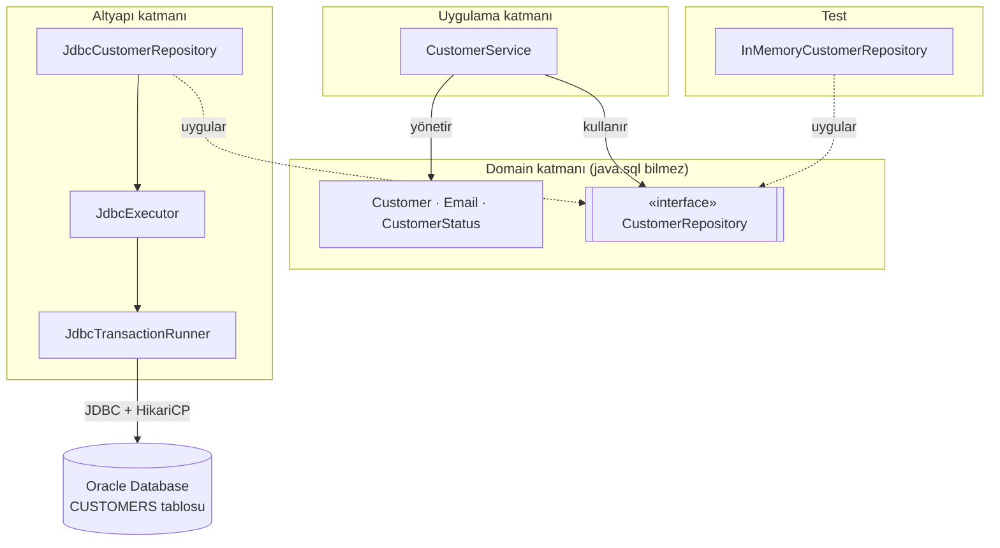
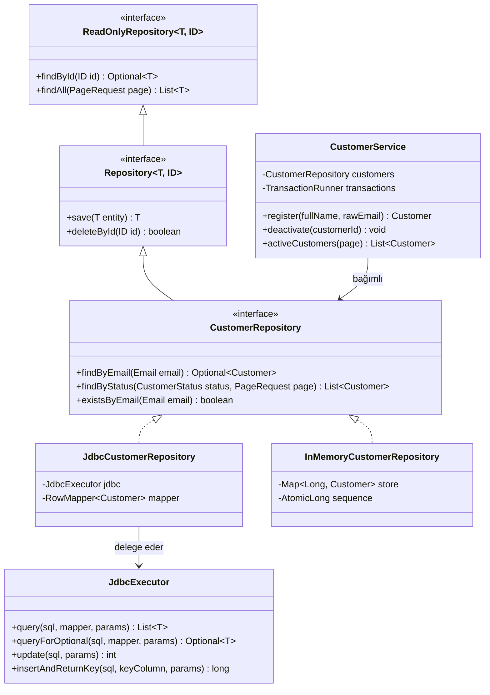
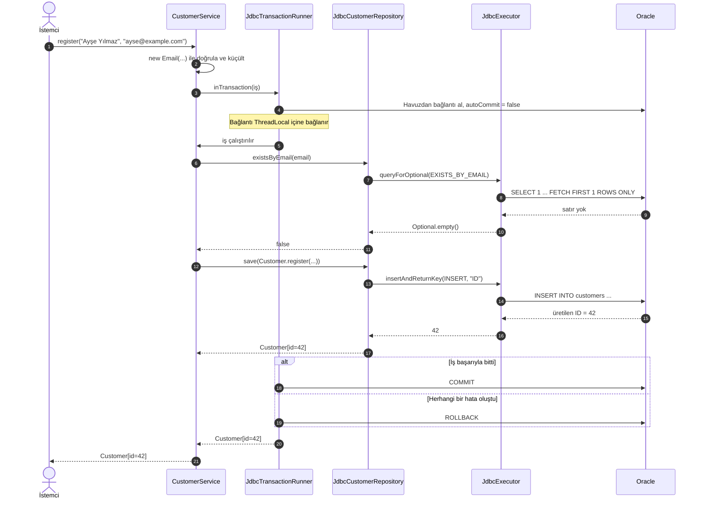

# Java'da Repository Deseni

### JDBC ve Oracle ile iş kurallarınızla veritabanınız arasına sağlam bir sınır çizmek

> Bir kod tabanı yaşlandıkça en çok neyi kaybeder diye sorsanız, cevabım "sınırlarını" olur. Repository deseni, bu sınırların en değerlisini, yani iş mantığıyla veritabanı arasındakini korumanın bildiğim en sade yolu.

**Bu yazıda kullanılanlar:** Java 21 · JDBC · Oracle Database (12c ve üzeri, ücretsiz Oracle Database Free dâhil) · HikariCP · JUnit

---

## İçindekiler

1. [Bir itirafla başlayalım](#1-bir-itirafla-başlayalım)
2. [Repository aslında ne?](#2-repository-aslında-ne)
3. [Mimari: oklar neden içeriyi gösteriyor?](#3-mimari-oklar-neden-içeriyi-gösteriyor)
4. [Proje yapısı ve bağımlılıklar](#4-proje-yapısı-ve-bağımlılıklar)
5. [Oracle tarafı: tablo ve kısıtlar](#5-oracle-tarafı-tablo-ve-kısıtlar)
6. [Domain modeli: davranışı olan nesneler](#6-domain-modeli-davranışı-olan-nesneler)
7. [Sözleşme: repository arayüzleri](#7-sözleşme-repository-arayüzleri)
8. [Altyapı: JDBC'yi tek bir yere hapsetmek](#8-altyapı-jdbcyi-tek-bir-yere-hapsetmek)
9. [Servis katmanı: SQL bilmeyen iş kuralları](#9-servis-katmanı-sql-bilmeyen-iş-kuralları)
10. [Parçaları birleştirmek: composition root](#10-parçaları-birleştirmek-composition-root)
11. [Test: repository'nin sessiz armağanı](#11-test-repositorynin-sessiz-armağanı)
12. [SOLID ve temiz kod haritası](#12-solid-ve-temiz-kod-haritası)
13. [Sık düşülen tuzaklar](#13-sık-düşülen-tuzaklar)
14. [Ne zaman gerek yok?](#14-ne-zaman-gerek-yok)
15. [Son söz](#15-son-söz)

---

## 1. Bir itirafla başlayalım

Kariyerimin ilk yıllarında üzerinde çalıştığım bir projede `CustomerService` adında, iki bin satıra yaklaşan bir sınıf vardı. İçinde iş kuralları da vardı, SQL cümleleri de, bağlantı açıp kapatan kodlar da. Her şey çalışıyordu; ta ki `customers` tablosundaki bir kolonun adını değiştirmemiz gerekene kadar. O gün on dört dosyaya dokunduk, iki hata canlı ortama kaçtı ve ben ilk kez kendime şu soruyu sordum: *Bu sınıf, veritabanının şeklini neden bu kadar iyi biliyor?*

O sınıfın küçültülmüş hâli aşağı yukarı şöyleydi:

```java
public class CustomerService {

    public void register(String name, String email) {
        try {
            Connection conn = DriverManager.getConnection(
                    "jdbc:oracle:thin:@//localhost:1521/FREEPDB1", "app", "secret123");
            Statement st = conn.createStatement();
            ResultSet rs = st.executeQuery(
                    "SELECT COUNT(*) FROM customers WHERE email = '" + email + "'");
            rs.next();
            if (rs.getInt(1) > 0) {
                System.out.println("E-posta zaten var!");
                return;
            }
            st.executeUpdate("INSERT INTO customers (full_name, email, status, created_at) "
                    + "VALUES ('" + name + "', '" + email + "', 'ACTIVE', SYSTIMESTAMP)");
            conn.close();
        } catch (Exception e) {
            e.printStackTrace();
        }
    }
}
```

İlk bakışta masum görünüyor. Oysa bu yirmi satırın içinde en az yedi ayrı sorun saklanıyor:

- **SQL Injection kapısı ardına kadar açık.** E-posta doğrudan SQL metnine ekleniyor; `' OR '1'='1` gibi bir girdi sorgunun anlamını değiştiriyor.
- **Kaynak sızıntısı var.** Arada bir hata çıkarsa `conn.close()` hiç çalışmıyor; `Statement` ve `ResultSet` ise zaten hiç kapatılmıyor.
- **Parola kaynak kodda.** Yani git geçmişinde, sonsuza dek.
- **Her çağrıda yeni bağlantı açılıyor.** Havuz yok; Oracle'a açılan her bağlantı ağ, kimlik doğrulama ve oturum maliyeti demek.
- **Hata yutuluyor.** `printStackTrace()` bir şey yapılmış gibi gösteriyor ama çağıran taraf hiçbir sorun yaşanmadığını sanıyor.
- **Test edilemiyor.** Bu metodu sınamak için ayakta bir Oracle veritabanı gerekiyor.
- **Sorumluluklar birbirine dolanmış.** İş kuralı ("aynı e-posta iki kez kullanılamaz") ile altyapı detayı ("bunu `COUNT(*)` ile sorgula") aynı satırlarda yaşıyor.

Son madde aslında diğerlerinin hepsinin kökü. Repository deseni tam olarak bu düğümü çözmek için var.

---

## 2. Repository aslında ne?

Martin Fowler, *Patterns of Enterprise Application Architecture* kitabında Repository'yi domain ile veri eşleme katmanı arasında duran ve domain nesnelerine **bellekteki bir koleksiyonmuş gibi** erişim sağlayan bir aracı olarak tanımlar. Eric Evans da *Domain-Driven Design* kitabında aynı fikri aggregate kavramı etrafında derinleştirir.

Bu tanımdaki en kıymetli kelime bence **koleksiyon**. Servis katmanı müşterilere, elinde duran bir `Set<Customer>` varmış gibi davranabilmeli: "Bana şu e-postaya sahip müşteriyi ver", "Bu müşteriyi sakla", "Bunu artık unut." Koleksiyonun arkasında Oracle mı, PostgreSQL mi, bir REST servisi mi yoksa düz bir `HashMap` mi olduğu, soruyu soranın derdi değildir.

Başka bir deyişle repository, **soruyu** o sorunun **nasıl cevaplandığından** ayırır. `findByEmail(email)` bir sorudur. `SELECT ... WHERE email = ?` ise o sorunun bugünkü cevaplanma biçimidir. Yarın araya bir önbellek girdiğinde soru değişmez; yalnızca cevaplama biçimi değişir.

### Repository mi, DAO mu?

Bu iki desen sık sık birbirine karıştırılır. Kardeş oldukları doğru ama ikiz değiller:

| Kriter | DAO (Data Access Object) | Repository |
|---|---|---|
| Odak noktası | Tablo ve veri kaynağı | Domain nesnesi ve aggregate |
| Konuştuğu dil | Veritabanının dili: `insert`, `update`, `selectByColumn` | İşin dili: `save`, `findByEmail`, `existsByEmail` |
| Arayüzün yaşadığı yer | Genellikle altyapı katmanı | Domain katmanı (implementasyonu altyapıda) |
| Döndürdüğü şey | Çoğunlukla satır ya da DTO | Davranışı olan domain nesnesi |
| Soyutlama seviyesi | Düşük, veritabanına yakın | Yüksek, iş kurallarına yakın |
| Tipik ölçek | Tablo başına bir DAO | Aggregate başına bir repository |

Pratikte iyi bir repository'nin içi, DAO'yu andıran disiplinli bir altyapı koduyla doldurulabilir. Bu yazıda yapacağımız da tam olarak bu: dışarıya işin dilini konuşan bir arayüz, içeride ise JDBC'yi tek bir yere hapseden küçük bir yardımcı.

---

## 3. Mimari: oklar neden içeriyi gösteriyor?

Tasarımın kalbinde tek bir karar yatıyor: **`CustomerRepository` arayüzü domain katmanında yaşar, onu uygulayan `JdbcCustomerRepository` ise altyapı katmanında.** Bu küçük yer değişikliği bağımlılık okunun yönünü tersine çevirir. Artık iş kuralları veritabanına değil, veritabanı kodu iş kurallarının tanımladığı sözleşmeye bağımlıdır.

**Çizim 1 – Katmanlar ve bağımlılık yönü**



Kesikli oklara dikkat edin: hem JDBC implementasyonu hem de testlerde kullanacağımız bellek içi implementasyon *aynı* arayüzü uyguluyor. `CustomerService` bu ikisini birbirinden ayırt edemez ve ayırt edememesi tasarımın başarısıdır. Robert C. Martin'in sık sık hatırlattığı gibi veritabanı bir **detaydır**. Detaylar politikaya bağımlı olmalı, politika detaylara değil.

---

## 4. Proje yapısı ve bağımlılıklar

```text
customer-repository/
├── pom.xml
└── src
    ├── main/java/tr/com/huseyinaydin
    │   ├── Application.java           → Composition root
    │   ├── customer/                  → Müşteri özelliği (feature)
    │   │   ├── domain/                → Saf iş modeli
    │   │   │   ├── Customer.java
    │   │   │   ├── CustomerStatus.java
    │   │   │   ├── Email.java
    │   │   │   └── CustomerRepository.java
    │   │   ├── application/           → Kullanım senaryoları
    │   │   │   ├── CustomerService.java
    │   │   │   ├── CustomerNotFoundException.java
    │   │   │   └── EmailAlreadyInUseException.java
    │   │   └── infrastructure/        → Oracle'a özgü repository
    │   │       ├── JdbcCustomerRepository.java
    │   │       └── CustomerRowMapper.java
    │   └── shared/                    → Bütün özelliklerin ortak kullandığı çekirdek
    │       ├── persistence/           → Genel sözleşmeler, istisnalar, transaction soyutlaması
    │       │   ├── ReadOnlyRepository.java
    │       │   ├── Repository.java
    │       │   ├── PageRequest.java
    │       │   ├── TransactionRunner.java
    │       │   ├── DataAccessException.java
    │       │   └── DuplicateKeyException.java
    │       └── infrastructure/jdbc/   → Yeniden kullanılabilir JDBC altyapısı
    │           ├── JdbcExecutor.java
    │           ├── JdbcTransactionRunner.java
    │           ├── RowMapper.java
    │           ├── SqlFunction.java
    │           ├── DatabaseSettings.java
    │           └── OracleDataSourceFactory.java
    ├── main/resources/db
    │   └── schema.sql                 → 5. bölümdeki tablo, kısıtlar ve indeks
    └── test/java/tr/com/huseyinaydin/customer   → Testler, üretim paketlerinin aynısında
        ├── domain/EmailTest.java
        ├── application/CustomerServiceTest.java
        └── infrastructure/InMemoryCustomerRepository.java
```

Yazı boyunca kendime tek bir kural koydum ve ona sadık kaldım: **`customer/domain` paketinde tek bir `java.sql` importu bile olmayacak.** Bu kuralı çiğnemek isteyen her satır, yanlış katmanda durduğunu kendisi itiraf eder. Paketler de aynı mantıkla dizildi: en üstte önce **özellik** (`customer`) ve ortak çekirdek (`shared`) gelir, katmanlar (`domain`, `application`, `infrastructure`) bunların içinde yaşar. Testler de test ettikleri sınıfla aynı paketi kullanır.

`pom.xml` dosyasında ihtiyacımız olan bağımlılıklar şunlar:

```xml
<properties>
    <maven.compiler.release>21</maven.compiler.release>
    <project.build.sourceEncoding>UTF-8</project.build.sourceEncoding>
</properties>

<dependencies>
    <!-- Oracle JDBC sürücüsü (JDK 11 ve üzeri) -->
    <dependency>
        <groupId>com.oracle.database.jdbc</groupId>
        <artifactId>ojdbc11</artifactId>
        <version>23.26.3.0.0</version>
    </dependency>

    <!-- Bağlantı havuzu -->
    <dependency>
        <groupId>com.zaxxer</groupId>
        <artifactId>HikariCP</artifactId>
        <version>7.0.2</version>
    </dependency>

    <dependency>
        <groupId>org.junit.jupiter</groupId>
        <artifactId>junit-jupiter</artifactId>
        <version>6.1.3</version>
        <scope>test</scope>
    </dependency>
</dependencies>
```

---

## 5. Oracle tarafı: tablo ve kısıtlar

```sql
CREATE TABLE customers (
    id          NUMBER(19)          GENERATED ALWAYS AS IDENTITY,
    full_name   VARCHAR2(150 CHAR)  NOT NULL,
    email       VARCHAR2(254 CHAR)  NOT NULL,
    status      VARCHAR2(10 CHAR)   DEFAULT 'ACTIVE' NOT NULL,
    created_at  TIMESTAMP           DEFAULT SYSTIMESTAMP NOT NULL,
    CONSTRAINT pk_customers         PRIMARY KEY (id),
    CONSTRAINT uq_customers_email   UNIQUE (email),
    CONSTRAINT ck_customers_status  CHECK (status IN ('ACTIVE', 'PASSIVE'))
);

CREATE INDEX ix_customers_status ON customers (status, id);
```

Bu birkaç satırın her birinin bir sebebi var:

- **`GENERATED ALWAYS AS IDENTITY`:** Oracle 12c'den beri sequence ve trigger ikilisiyle uğraşmaya gerek yok. Kimliği veritabanı üretir, biz yalnızca geri okuruz.
- **`VARCHAR2(150 CHAR)`:** Varsayılan `BYTE` semantiğinde sınır byte olarak sayılır. AL32UTF8 karakter setinde `ş`, `ğ`, `ü` gibi harfler iki byte tuttuğu için "Gülşen Çağlayanoğlu" gibi bir isim beklediğinizden çok daha erken sığmaz hâle gelir. `CHAR` ile sınırı karakter cinsinden koyarız.
- **`uq_customers_email`:** Uygulamadaki "bu e-posta var mı?" kontrolü kullanıcı deneyimi içindir; asıl hakem bu kısıttır. Nedenini [9. bölümde](#9-servis-katmanı-sql-bilmeyen-iş-kuralları) anlatacağım.
- **`ix_customers_status (status, id)`:** Duruma göre sayfalı sorgu hem filtreyi hem sıralamayı tek indeksten karşılayabilsin diye.

---

## 6. Domain modeli: davranışı olan nesneler

Repository'nin döndürdüğü nesneler yalnızca getter ve setter'dan ibaret "anemik" sınıflar olursa, desenin değerinin yarısını çöpe atmış oluruz. Çünkü o zaman iş kuralları yine servislere dağılır. Bu yüzden işe domain'i doğru kurarak başlıyorum.

### Değer nesnesi: `Email`

Bir e-posta adresinin kimliği yoktur; değeri neyse odur. Aynı metni taşıyan iki `Email` birbirinin aynısıdır. Java `record` bu iş için biçilmiş kaftan: değişmez, `equals` ve `hashCode` hazır gelir, doğrulamayı da kurucuda yaparız.

```java
package tr.com.huseyinaydin.customer.domain;

import java.util.Locale;
import java.util.Objects;
import java.util.regex.Pattern;

public record Email(String value) {

    private static final Pattern FORMAT = Pattern.compile("^[^@\\s]+@[^@\\s]+\\.[^@\\s]+$");

    public Email {
        Objects.requireNonNull(value, "E-posta boş olamaz");
        value = value.trim().toLowerCase(Locale.ROOT);
        if (!FORMAT.matcher(value).matches()) {
            throw new IllegalArgumentException("Geçersiz e-posta adresi: " + value);
        }
    }
}
```

> **Türk geliştiriciler için küçük ama hayati bir not:** `Locale.ROOT` detayını sakın atlamayın. Varsayılan yerel ayarı Türkçe olan bir JVM'de `"IREM@EXAMPLE.COM".toLowerCase()` çağrısı `ırem@example.com` üretir, yani noktasız ı ile. Meşhur "Turkish I" problemi budur. Benzersizlik kontrolünüz bir sabah hiçbir hata vermeden sessizce çöker.

### Entity: `Customer`

Entity ise tam tersidir: değerleri değişse bile kimliğiyle var olmaya devam eder. E-posta adresini değiştiren bir müşteri hâlâ aynı müşteridir.

```java
package tr.com.huseyinaydin.customer.domain;

public enum CustomerStatus {
    ACTIVE,
    PASSIVE
}
```

```java
package tr.com.huseyinaydin.customer.domain;

import java.time.LocalDateTime;
import java.util.Objects;

public final class Customer {

    private final Long id;
    private final String fullName;
    private final LocalDateTime createdAt;
    private Email email;
    private CustomerStatus status;

    private Customer(Long id, String fullName, Email email,
                     CustomerStatus status, LocalDateTime createdAt) {
        this.id = id;
        this.fullName = requireText(fullName);
        this.email = Objects.requireNonNull(email, "E-posta zorunludur");
        this.status = Objects.requireNonNull(status, "Durum zorunludur");
        this.createdAt = Objects.requireNonNull(createdAt, "Oluşturulma zamanı zorunludur");
    }

    /** Yeni bir müşteri doğar. Kimliğini henüz bilmiyoruz; onu veritabanı verecek. */
    public static Customer register(String fullName, Email email) {
        return new Customer(null, fullName, email, CustomerStatus.ACTIVE, LocalDateTime.now());
    }

    /** Daha önce kaydedilmiş bir müşteri veritabanından geri çağrılır. */
    public static Customer restore(long id, String fullName, Email email,
                                   CustomerStatus status, LocalDateTime createdAt) {
        return new Customer(id, fullName, email, status, createdAt);
    }

    public Customer withId(long newId) {
        if (!isNew()) {
            throw new IllegalStateException("Kimliği olan bir müşteriye yeni kimlik verilemez: " + id);
        }
        return new Customer(newId, fullName, email, status, createdAt);
    }

    public void deactivate() {
        if (status == CustomerStatus.PASSIVE) {
            throw new IllegalStateException("Müşteri zaten pasif: " + id);
        }
        status = CustomerStatus.PASSIVE;
    }

    public void changeEmail(Email newEmail) {
        this.email = Objects.requireNonNull(newEmail, "Yeni e-posta zorunludur");
    }

    public boolean isNew() {
        return id == null;
    }

    public Long id() { return id; }

    public String fullName() { return fullName; }

    public Email email() { return email; }

    public CustomerStatus status() { return status; }

    public LocalDateTime createdAt() { return createdAt; }

    @Override
    public boolean equals(Object other) {
        if (this == other) {
            return true; // Henüz kimliği olmayan bir nesne de kendisine eşittir.
        }
        return other instanceof Customer that && id != null && id.equals(that.id);
    }

    @Override
    public int hashCode() {
        return Objects.hashCode(id);
    }

    @Override
    public String toString() {
        return "Customer[id=%s, fullName=%s, email=%s, status=%s]"
                .formatted(id, fullName, email.value(), status);
    }

    private static String requireText(String value) {
        if (value == null || value.isBlank()) {
            throw new IllegalArgumentException("Ad soyad boş olamaz");
        }
        return value.trim();
    }
}
```

Bu sınıfta bilinçli olarak verdiğim birkaç karar var:

1. **İki fabrika metodu, iki ayrı doğum hikâyesi.** `register` dünyaya yeni gelen bir müşteriyi, `restore` ise veritabanından geri dönen bir müşteriyi temsil eder. Kurucu `private` olduğu için geçersiz bir müşteri üretmenin yolu yoktur.
2. **Setter yok, davranış var.** Durumu dışarıdan `setStatus(PASSIVE)` ile değiştirmek yerine `deactivate()` çağrılır. "Zaten pasif olan müşteri yeniden pasife alınamaz" kuralı nesnenin içinde korunur. Kapsülleme dediğimiz şey tam olarak budur.
3. **Eşitlik kimliğe göre.** İki `Customer` aynı `id`'ye sahipse aynı müşteridir; adları farklı olsa bile.

---

## 7. Sözleşme: repository arayüzleri

Önce her aggregate için tekrar kullanabileceğimiz genel sözleşmeyi, okuma ve yazma olarak **iki parçaya** bölerek tanımlıyorum.

```java
package tr.com.huseyinaydin.shared.persistence;

import java.util.List;
import java.util.Optional;

/** Yalnızca okuma yapan istemciler için dar sözleşme. */
public interface ReadOnlyRepository<T, ID> {

    Optional<T> findById(ID id);

    List<T> findAll(PageRequest page);
}
```

```java
package tr.com.huseyinaydin.shared.persistence;

/** Okuma sözleşmesini yazma yetenekleriyle genişletir. */
public interface Repository<T, ID> extends ReadOnlyRepository<T, ID> {

    /**
     * Yeni nesneyi ekler, var olanı günceller.
     *
     * @throws DuplicateKeyException benzersizlik kuralı ihlal edilirse
     */
    T save(T entity);

    boolean deleteById(ID id);
}
```

```java
package tr.com.huseyinaydin.shared.persistence;

public record PageRequest(int page, int size) {

    private static final int MAX_SIZE = 500;

    public PageRequest {
        if (page < 0) {
            throw new IllegalArgumentException("Sayfa numarası negatif olamaz: " + page);
        }
        if (size < 1 || size > MAX_SIZE) {
            throw new IllegalArgumentException("Sayfa boyutu 1 ile " + MAX_SIZE + " arasında olmalı: " + size);
        }
    }

    public static PageRequest of(int page, int size) {
        return new PageRequest(page, size);
    }

    public long offset() {
        return (long) page * size;
    }
}
```

Sonra müşteriye özgü sözleşme geliyor. Dikkat ederseniz bu arayüz `customer/domain` paketinde duruyor ve tek kelime SQL bilmiyor:

```java
package tr.com.huseyinaydin.customer.domain;

import tr.com.huseyinaydin.shared.persistence.PageRequest;
import tr.com.huseyinaydin.shared.persistence.Repository;

import java.util.List;
import java.util.Optional;

public interface CustomerRepository extends Repository<Customer, Long> {

    Optional<Customer> findByEmail(Email email);

    List<Customer> findByStatus(CustomerStatus status, PageRequest page);

    boolean existsByEmail(Email email);
}
```

Bu sözleşmelerin arkasındaki düşünceyi üç maddede özetleyebilirim:

- **Neden iki parça?** Rapor üreten bir servisin `save` ya da `deleteById` metotlarını görmesi için hiçbir sebep yok. `ReadOnlyRepository` alan bir sınıf, veriyi değiştiremeyeceğinin garantisini derleyiciden alır.
- **Neden `Optional`?** `findById` asla `null` döndürmez. "Bulunamadı" ihtimali sözleşmenin bir parçasıdır ve tip sistemine yazılmıştır.
- **Neden sayfalama zorunlu?** Parametresiz bir `findAll()` saatli bombadır. Bugün 300 müşteriniz var; iki yıl sonra 3 milyon olduğunda bu metot bir gece sizi `OutOfMemoryError` ile uyandırır.

İstisnalar da sözleşmenin parçasıdır. Bu yüzden onları altyapıya değil, sözleşmelerin yanına koyuyorum. Böylece servis katmanı `DuplicateKeyException` yakalayabilir ama `java.sql.SQLException` diye bir şeyin varlığından haberdar olmak zorunda kalmaz:

```java
package tr.com.huseyinaydin.shared.persistence;

/** Veri erişimindeki tüm hataların teknolojiden bağımsız ortak atası. */
public class DataAccessException extends RuntimeException {

    public DataAccessException(String message) {
        super(message);
    }

    public DataAccessException(String message, Throwable cause) {
        super(message, cause);
    }
}
```

```java
package tr.com.huseyinaydin.shared.persistence;

/** Benzersizlik kuralı ihlal edildiğinde fırlatılır (Oracle'da ORA-00001). */
public class DuplicateKeyException extends DataAccessException {

    public DuplicateKeyException(String message) {
        super(message);
    }

    public DuplicateKeyException(String message, Throwable cause) {
        super(message, cause);
    }
}
```

**Çizim 2 – Sözleşmeler ve implementasyonlar arasındaki ilişki**



---

## 8. Altyapı: JDBC'yi tek bir yere hapsetmek

Ham JDBC kodunun asıl yorucu tarafı, her sorguda tekrarlanan törendir: bağlantıyı al, statement hazırla, parametreleri bağla, sonucu oku, hepsini doğru sırayla kapat, hatayı çevir. Bu töreni her repository metoduna kopyalamak yerine tek bir sınıfa topluyorum. Repository'lere geriye yalnızca **ne sorulacağı** kalıyor.

### 8.1 İki küçük fonksiyonel arayüz

```java
package tr.com.huseyinaydin.shared.infrastructure.jdbc;

import java.sql.ResultSet;
import java.sql.SQLException;

/** Bir satırı nesneye çevirir. */
@FunctionalInterface
public interface RowMapper<T> {

    T mapRow(ResultSet resultSet) throws SQLException;
}
```

```java
package tr.com.huseyinaydin.shared.infrastructure.jdbc;

import java.sql.SQLException;

/** java.util.function.Function'ın SQLException fırlatabilen hâli. */
@FunctionalInterface
interface SqlFunction<T, R> {

    R apply(T input) throws SQLException;
}
```

### 8.2 Transaction: repository'nin işi değil

Repository içinde `commit()` çağırmak en yaygın ve en sinsi hatalardan biridir. Müşteriyi kaydedip ardından ona bir hoş geldin kuponu tanımladığınızı düşünün. İkinci adım patlarsa ilki çoktan commit edilmiştir ve elinizde kuponsuz, yarım bir kayıt kalır. Transaction **bir iş senaryosunun** sınırıdır, tek bir tablonun değil. Bu yüzden sınırı servis çizer, repository yalnızca o sınırın içinde çalışır.

Servis katmanı bunu teknolojiden bağımsız bir arayüz üzerinden ister:

```java
package tr.com.huseyinaydin.shared.persistence;

import java.util.function.Supplier;

/** Bir iş senaryosunu tek bir transaction içinde çalıştırır. */
public interface TransactionRunner {

    <R> R inTransaction(Supplier<R> work);

    default void runInTransaction(Runnable work) {
        inTransaction(() -> {
            work.run();
            return null;
        });
    }
}
```

JDBC karşılığı ise bağlantıyı bir `ThreadLocal` içinde tutar. Böylece aynı iş parçacığında çalışan bütün repository çağrıları **aynı bağlantıyı**, dolayısıyla aynı transaction'ı paylaşır:

```java
package tr.com.huseyinaydin.shared.infrastructure.jdbc;

import tr.com.huseyinaydin.shared.persistence.DataAccessException;
import tr.com.huseyinaydin.shared.persistence.TransactionRunner;

import javax.sql.DataSource;
import java.sql.Connection;
import java.sql.SQLException;
import java.util.Objects;
import java.util.function.Supplier;

/** Bağlantıların yaşam döngüsünü ve transaction sınırlarını yönetir. */
public final class JdbcTransactionRunner implements TransactionRunner {

    private final DataSource dataSource;
    private final ThreadLocal<Connection> boundConnection = new ThreadLocal<>();

    public JdbcTransactionRunner(DataSource dataSource) {
        this.dataSource = Objects.requireNonNull(dataSource, "DataSource zorunludur");
    }

    @Override
    public <R> R inTransaction(Supplier<R> work) {
        if (boundConnection.get() != null) {
            return work.get(); // Zaten bir transaction içindeyiz: ona katıl.
        }
        try (Connection connection = dataSource.getConnection()) {
            connection.setAutoCommit(false);
            boundConnection.set(connection);
            try {
                R result = work.get();
                connection.commit();
                return result;
            } catch (RuntimeException | Error | SQLException failure) {
                rollbackQuietly(connection, failure);
                throw failure;
            } finally {
                boundConnection.remove();
            }
        } catch (SQLException e) {
            throw new DataAccessException("Transaction tamamlanamadı", e);
        }
    }

    /** Açık bir transaction varsa onun bağlantısını, yoksa havuzdan yeni bir bağlantı kullanır. */
    <R> R withConnection(SqlFunction<Connection, R> action) throws SQLException {
        Connection bound = boundConnection.get();
        if (bound != null) {
            return action.apply(bound); // Bağlantının sahibi transaction; burada kapatmıyoruz.
        }
        try (Connection connection = dataSource.getConnection()) {
            return action.apply(connection); // Transaction yok: autoCommit açık, tek ifadelik iş.
        }
    }

    private static void rollbackQuietly(Connection connection, Throwable original) {
        try {
            connection.rollback();
        } catch (SQLException rollbackFailure) {
            original.addSuppressed(rollbackFailure);
        }
    }
}
```

> **Oracle'a özgü bir uyarı:** Oracle JDBC sürücüsünün eskiden beri belgelenmiş davranışına göre `autoCommit` kapalıyken bağlantı, commit ya da rollback yapılmadan kapatılırsa bekleyen işlem **commit edilir**. Yani "hata olursa bağlantı kapanınca nasılsa geri alınır" varsayımı Oracle'da tehlikelidir. Yukarıdaki kodda rollback'in her hata yolunda açıkça çağrılmasının sebebi bu.

### 8.3 `JdbcExecutor`: törenin tek adresi

```java
package tr.com.huseyinaydin.shared.infrastructure.jdbc;

import tr.com.huseyinaydin.shared.persistence.DataAccessException;
import tr.com.huseyinaydin.shared.persistence.DuplicateKeyException;

import java.sql.Connection;
import java.sql.PreparedStatement;
import java.sql.ResultSet;
import java.sql.SQLException;
import java.util.ArrayList;
import java.util.List;
import java.util.Objects;
import java.util.Optional;

/** Bağlantı, statement, kaynak kapatma ve hata çevirisi gibi tekrar eden JDBC törenini tek yerde toplar. */
public final class JdbcExecutor {

    private static final int ORA_UNIQUE_VIOLATION = 1; // ORA-00001
    private static final int FETCH_SIZE = 100;         // Oracle'ın varsayılanı 10 satırdır.

    private final JdbcTransactionRunner transactions;

    public JdbcExecutor(JdbcTransactionRunner transactions) {
        this.transactions = Objects.requireNonNull(transactions, "JdbcTransactionRunner zorunludur");
    }

    public <T> List<T> query(String sql, RowMapper<T> mapper, Object... params) {
        return execute(sql, connection -> {
            try (PreparedStatement statement = connection.prepareStatement(sql)) {
                statement.setFetchSize(FETCH_SIZE);
                bind(statement, params);
                try (ResultSet resultSet = statement.executeQuery()) {
                    List<T> rows = new ArrayList<>();
                    while (resultSet.next()) {
                        rows.add(mapper.mapRow(resultSet));
                    }
                    return rows;
                }
            }
        });
    }

    public <T> Optional<T> queryForOptional(String sql, RowMapper<T> mapper, Object... params) {
        List<T> rows = query(sql, mapper, params);
        if (rows.size() > 1) {
            throw new DataAccessException("Tek satır beklenirken " + rows.size() + " satır döndü: " + sql);
        }
        return rows.stream().findFirst();
    }

    public int update(String sql, Object... params) {
        return execute(sql, connection -> {
            try (PreparedStatement statement = connection.prepareStatement(sql)) {
                bind(statement, params);
                return statement.executeUpdate();
            }
        });
    }

    public long insertAndReturnKey(String sql, String keyColumn, Object... params) {
        return execute(sql, connection -> {
            try (PreparedStatement statement = connection.prepareStatement(sql, new String[] {keyColumn})) {
                bind(statement, params);
                statement.executeUpdate();
                try (ResultSet keys = statement.getGeneratedKeys()) {
                    if (!keys.next()) {
                        throw new DataAccessException("Üretilen anahtar okunamadı: " + sql);
                    }
                    return keys.getLong(1);
                }
            }
        });
    }

    private <R> R execute(String sql, SqlFunction<Connection, R> action) {
        try {
            return transactions.withConnection(action);
        } catch (SQLException e) {
            throw translate(sql, e);
        }
    }

    private static void bind(PreparedStatement statement, Object... params) throws SQLException {
        for (int i = 0; i < params.length; i++) {
            statement.setObject(i + 1, params[i]);
        }
    }

    private static DataAccessException translate(String sql, SQLException e) {
        if (e.getErrorCode() == ORA_UNIQUE_VIOLATION) {
            return new DuplicateKeyException("Benzersizlik kısıtı ihlal edildi", e);
        }
        return new DataAccessException("SQL çalıştırılamadı: " + sql, e);
    }
}
```

`JdbcExecutor`'ın kendi `DataSource`'u yok; bağlantıyı daima `JdbcTransactionRunner` üzerinden ister. Bu bilinçli bir tercih. Aynı `DataSource`'u iki farklı sınıfa ayrı ayrı vermek, bir gün yanlışlıkla iki farklı `DataSource` verme hatasına kapı aralar. O gün de repository'ler transaction'ın dışında çalışmaya başlar ve bunu fark etmeniz haftalar alabilir.

### 8.4 Repository'nin kendisi

Bütün altyapı hazır olduğunda repository şaşırtıcı derecede sade kalıyor. Bu sadelik tesadüf değil; tekrar eden her şey `JdbcExecutor`'a taşındığı için repository yalnızca *ne sorulacağını* ve *cevabın nasıl okunacağını* biliyor.

```java
package tr.com.huseyinaydin.customer.infrastructure;

import tr.com.huseyinaydin.customer.domain.Customer;
import tr.com.huseyinaydin.customer.domain.CustomerStatus;
import tr.com.huseyinaydin.customer.domain.Email;
import tr.com.huseyinaydin.shared.infrastructure.jdbc.RowMapper;

import java.sql.ResultSet;
import java.sql.SQLException;
import java.time.LocalDateTime;

/** Bir CUSTOMERS satırını Customer nesnesine çevirir. Tek sorumluluğu budur. */
final class CustomerRowMapper implements RowMapper<Customer> {

    @Override
    public Customer mapRow(ResultSet resultSet) throws SQLException {
        return Customer.restore(
                resultSet.getLong("id"),
                resultSet.getString("full_name"),
                new Email(resultSet.getString("email")),
                CustomerStatus.valueOf(resultSet.getString("status")),
                resultSet.getObject("created_at", LocalDateTime.class));
    }
}
```

```java
package tr.com.huseyinaydin.customer.infrastructure;

import tr.com.huseyinaydin.customer.domain.Customer;
import tr.com.huseyinaydin.customer.domain.CustomerRepository;
import tr.com.huseyinaydin.customer.domain.CustomerStatus;
import tr.com.huseyinaydin.customer.domain.Email;
import tr.com.huseyinaydin.shared.infrastructure.jdbc.JdbcExecutor;
import tr.com.huseyinaydin.shared.infrastructure.jdbc.RowMapper;
import tr.com.huseyinaydin.shared.persistence.DataAccessException;
import tr.com.huseyinaydin.shared.persistence.PageRequest;

import java.util.List;
import java.util.Objects;
import java.util.Optional;

public final class JdbcCustomerRepository implements CustomerRepository {

    private static final String SELECT_CUSTOMER =
            "SELECT id, full_name, email, status, created_at FROM customers";

    private static final String FIND_BY_ID = SELECT_CUSTOMER + " WHERE id = ?";
    private static final String FIND_BY_EMAIL = SELECT_CUSTOMER + " WHERE email = ?";
    private static final String FIND_PAGE =
            SELECT_CUSTOMER + " ORDER BY id OFFSET ? ROWS FETCH NEXT ? ROWS ONLY";
    private static final String FIND_BY_STATUS =
            SELECT_CUSTOMER + " WHERE status = ? ORDER BY id OFFSET ? ROWS FETCH NEXT ? ROWS ONLY";
    private static final String EXISTS_BY_EMAIL =
            "SELECT 1 FROM customers WHERE email = ? FETCH FIRST 1 ROWS ONLY";
    private static final String INSERT =
            "INSERT INTO customers (full_name, email, status, created_at) VALUES (?, ?, ?, ?)";
    private static final String UPDATE =
            "UPDATE customers SET email = ?, status = ? WHERE id = ?";
    private static final String DELETE_BY_ID = "DELETE FROM customers WHERE id = ?";

    private final JdbcExecutor jdbc;
    private final RowMapper<Customer> mapper = new CustomerRowMapper();

    public JdbcCustomerRepository(JdbcExecutor jdbc) {
        this.jdbc = Objects.requireNonNull(jdbc, "JdbcExecutor zorunludur");
    }

    @Override
    public Optional<Customer> findById(Long id) {
        return jdbc.queryForOptional(FIND_BY_ID, mapper, id);
    }

    @Override
    public Optional<Customer> findByEmail(Email email) {
        return jdbc.queryForOptional(FIND_BY_EMAIL, mapper, email.value());
    }

    @Override
    public List<Customer> findAll(PageRequest page) {
        return jdbc.query(FIND_PAGE, mapper, page.offset(), page.size());
    }

    @Override
    public List<Customer> findByStatus(CustomerStatus status, PageRequest page) {
        return jdbc.query(FIND_BY_STATUS, mapper, status.name(), page.offset(), page.size());
    }

    @Override
    public boolean existsByEmail(Email email) {
        return jdbc.queryForOptional(EXISTS_BY_EMAIL, resultSet -> true, email.value()).isPresent();
    }

    @Override
    public Customer save(Customer customer) {
        return customer.isNew() ? insert(customer) : update(customer);
    }

    @Override
    public boolean deleteById(Long id) {
        return jdbc.update(DELETE_BY_ID, id) > 0;
    }

    private Customer insert(Customer customer) {
        long id = jdbc.insertAndReturnKey(INSERT, "ID",
                customer.fullName(),
                customer.email().value(),
                customer.status().name(),
                customer.createdAt());
        return customer.withId(id);
    }

    private Customer update(Customer customer) {
        int affectedRows = jdbc.update(UPDATE,
                customer.email().value(),
                customer.status().name(),
                customer.id());
        if (affectedRows == 0) {
            throw new DataAccessException("Güncellenecek müşteri bulunamadı: id=" + customer.id());
        }
        return customer;
    }
}
```

### 8.5 Bağlantı havuzu ve ayarlar

Bağlantı bilgileri koda değil ortama aittir. `record` kullanırken bir noktaya dikkat etmek gerekiyor: otomatik üretilen `toString` bütün alanları yazdırır. Parolanın bir gün bir log satırına düşmemesi için onu eziyorum:

```java
package tr.com.huseyinaydin.shared.infrastructure.jdbc;

/** Örnek DB_URL: jdbc:oracle:thin:@//localhost:1521/FREEPDB1 */
public record DatabaseSettings(String url, String username, String password, int maxPoolSize) {

    public static DatabaseSettings fromEnvironment() {
        return new DatabaseSettings(
                required("DB_URL"),
                required("DB_USER"),
                required("DB_PASSWORD"),
                Integer.parseInt(System.getenv().getOrDefault("DB_POOL_SIZE", "10")));
    }

    private static String required(String key) {
        String value = System.getenv(key);
        if (value == null || value.isBlank()) {
            throw new IllegalStateException(key + " ortam değişkeni tanımlı değil");
        }
        return value;
    }

    @Override
    public String toString() {
        return "DatabaseSettings[url=%s, username=%s, password=***, maxPoolSize=%d]"
                .formatted(url, username, maxPoolSize);
    }
}
```

```java
package tr.com.huseyinaydin.shared.infrastructure.jdbc;

import com.zaxxer.hikari.HikariConfig;
import com.zaxxer.hikari.HikariDataSource;

public final class OracleDataSourceFactory {

    private OracleDataSourceFactory() {
    }

    public static HikariDataSource create(DatabaseSettings settings) {
        HikariConfig config = new HikariConfig();
        config.setJdbcUrl(settings.url());
        config.setUsername(settings.username());
        config.setPassword(settings.password());
        config.setMaximumPoolSize(settings.maxPoolSize());
        config.setPoolName("customer-pool");
        return new HikariDataSource(config);
    }
}
```

### 8.6 Oracle'a özgü detaylar tek tabloda

| Konu | Oracle'daki davranış | Kodumuzdaki karşılığı |
|---|---|---|
| Üretilen anahtar | `RETURN_GENERATED_KEYS` kimlik yerine `ROWID` döndürebilir | `prepareStatement(sql, new String[] {"ID"})` |
| Sayfalama | `LIMIT` yoktur; 12c'den beri standart sözdizimi kullanılır | `OFFSET ? ROWS FETCH NEXT ? ROWS ONLY` |
| Fetch size | Sürücü varsayılan olarak her gidiş-dönüşte 10 satır getirir | `statement.setFetchSize(100)` |
| Benzersizlik ihlali | `ORA-00001`, `getErrorCode()` değeri `1` | `DuplicateKeyException`'a çevrilir |
| Kapanışta commit | `autoCommit` kapalıyken bekleyen işlem commit edilir | Her hata yolunda açık `rollback()` |
| Metin uzunluğu | `VARCHAR2(n)` varsayılan olarak byte sayar | `VARCHAR2(n CHAR)` |
| Boş metin | `''` değeri `NULL` olarak saklanır | Domain boş metne zaten izin vermez |
| Tanımlayıcılar | Tırnaksız tablo ve kolon adları büyük harfe çevrilir | Anahtar kolonu `"ID"` olarak verilir |

---

## 9. Servis katmanı: SQL bilmeyen iş kuralları

Şimdi yazının başındaki o dağınık metodu yeniden yazabiliriz. Aynı iş, ama bu kez iş kuralı kendi dilinde konuşuyor:

```java
package tr.com.huseyinaydin.customer.application;

import tr.com.huseyinaydin.customer.domain.Customer;
import tr.com.huseyinaydin.customer.domain.CustomerRepository;
import tr.com.huseyinaydin.customer.domain.CustomerStatus;
import tr.com.huseyinaydin.customer.domain.Email;
import tr.com.huseyinaydin.shared.persistence.DuplicateKeyException;
import tr.com.huseyinaydin.shared.persistence.PageRequest;
import tr.com.huseyinaydin.shared.persistence.TransactionRunner;

import java.util.List;
import java.util.Objects;

public final class CustomerService {

    private final CustomerRepository customers;
    private final TransactionRunner transactions;

    public CustomerService(CustomerRepository customers, TransactionRunner transactions) {
        this.customers = Objects.requireNonNull(customers, "CustomerRepository zorunludur");
        this.transactions = Objects.requireNonNull(transactions, "TransactionRunner zorunludur");
    }

    public Customer register(String fullName, String rawEmail) {
        Email email = new Email(rawEmail);
        return transactions.inTransaction(() -> {
            if (customers.existsByEmail(email)) {
                throw new EmailAlreadyInUseException(email);
            }
            try {
                return customers.save(Customer.register(fullName, email));
            } catch (DuplicateKeyException raceCondition) {
                throw new EmailAlreadyInUseException(email, raceCondition);
            }
        });
    }

    public void deactivate(long customerId) {
        transactions.runInTransaction(() -> {
            Customer customer = customers.findById(customerId)
                    .orElseThrow(() -> new CustomerNotFoundException(customerId));
            customer.deactivate();
            customers.save(customer);
        });
    }

    public List<Customer> activeCustomers(PageRequest page) {
        return customers.findByStatus(CustomerStatus.ACTIVE, page);
    }
}
```

```java
package tr.com.huseyinaydin.customer.application;

import tr.com.huseyinaydin.customer.domain.Email;

public class EmailAlreadyInUseException extends RuntimeException {

    public EmailAlreadyInUseException(Email email) {
        this(email, null);
    }

    public EmailAlreadyInUseException(Email email, Throwable cause) {
        super("Bu e-posta adresi zaten kullanımda: " + email.value(), cause);
    }
}
```

```java
package tr.com.huseyinaydin.customer.application;

public class CustomerNotFoundException extends RuntimeException {

    public CustomerNotFoundException(long customerId) {
        super("Müşteri bulunamadı: id=" + customerId);
    }
}
```

`existsByEmail` kontrolü ile veritabanındaki `UNIQUE` kısıtı ilk bakışta aynı işi iki kez yapıyor gibi görünebilir. Öyle değil. **Kontrol, kullanıcıya anlaşılır bir mesaj vermek içindir; kısıt ise gerçeğin tek hakemidir.** İki istek aynı milisaniyede gelirse ikisi de kontrolden geçer ama ikisinden yalnızca biri kısıttan geçebilir. `catch (DuplicateKeyException)` bloğu o nadir ama gerçek anı karşılıyor. Bu ayrımı içselleştirmek, eşzamanlılıkla ilgili pek çok hatanın önünü kendiliğinden kesiyor.

**Çizim 3 – Yeni müşteri kaydının adım adım yolculuğu**



---

## 10. Parçaları birleştirmek: composition root

Bağımlılıkları bilerek hiçbir framework kullanmadan, elle bağlıyorum. Spring gibi bir bağımlılık enjeksiyonu konteynerinin perde arkasında yaptığını çıplak gözle görmenin en iyi yolu bu. Bütün `new` anahtar kelimeleri tek bir yerde toplanıyor; buna **composition root** diyoruz:

```java
package tr.com.huseyinaydin;

import com.zaxxer.hikari.HikariDataSource;
import tr.com.huseyinaydin.customer.application.CustomerService;
import tr.com.huseyinaydin.customer.domain.Customer;
import tr.com.huseyinaydin.customer.domain.CustomerRepository;
import tr.com.huseyinaydin.customer.infrastructure.JdbcCustomerRepository;
import tr.com.huseyinaydin.shared.infrastructure.jdbc.DatabaseSettings;
import tr.com.huseyinaydin.shared.infrastructure.jdbc.JdbcExecutor;
import tr.com.huseyinaydin.shared.infrastructure.jdbc.JdbcTransactionRunner;
import tr.com.huseyinaydin.shared.infrastructure.jdbc.OracleDataSourceFactory;
import tr.com.huseyinaydin.shared.persistence.PageRequest;

public final class Application {

    public static void main(String[] args) {
        try (HikariDataSource dataSource = OracleDataSourceFactory.create(DatabaseSettings.fromEnvironment())) {
            JdbcTransactionRunner transactions = new JdbcTransactionRunner(dataSource);
            CustomerRepository customers = new JdbcCustomerRepository(new JdbcExecutor(transactions));
            CustomerService service = new CustomerService(customers, transactions);

            Customer ayse = service.register("Ayşe Yılmaz", "Ayse.Yilmaz@Example.com");
            System.out.println("Kaydedildi: " + ayse);

            service.deactivate(ayse.id());
            System.out.println("Aktif müşteriler: " + service.activeCustomers(PageRequest.of(0, 20)));
        }
    }
}
```

Çalıştırmadan önce ortam değişkenlerini tanımlamak yeterli:

```bash
export DB_URL="jdbc:oracle:thin:@//localhost:1521/FREEPDB1"
export DB_USER="app_user"
export DB_PASSWORD="********"
mvn compile exec:java -Dexec.mainClass=tr.com.huseyinaydin.Application
```

---

## 11. Test: repository'nin sessiz armağanı

Repository desenine yaptığım yatırımın karşılığını en net testlerde alıyorum. Servis bir arayüze bağımlı olduğu için, testte o arayüzün bellek içi bir uygulamasını vermek yetiyor:

```java
package tr.com.huseyinaydin.customer.infrastructure;

import tr.com.huseyinaydin.customer.domain.Customer;
import tr.com.huseyinaydin.customer.domain.CustomerRepository;
import tr.com.huseyinaydin.customer.domain.CustomerStatus;
import tr.com.huseyinaydin.customer.domain.Email;
import tr.com.huseyinaydin.shared.persistence.DataAccessException;
import tr.com.huseyinaydin.shared.persistence.DuplicateKeyException;
import tr.com.huseyinaydin.shared.persistence.PageRequest;

import java.util.Comparator;
import java.util.List;
import java.util.Map;
import java.util.Optional;
import java.util.concurrent.ConcurrentHashMap;
import java.util.concurrent.atomic.AtomicLong;
import java.util.stream.Stream;

/** CustomerRepository'nin testler için bellek içi ve sözleşmeye sadık uygulaması. */
public final class InMemoryCustomerRepository implements CustomerRepository {

    private final Map<Long, Customer> store = new ConcurrentHashMap<>();
    private final AtomicLong sequence = new AtomicLong();

    @Override
    public Optional<Customer> findById(Long id) {
        return Optional.ofNullable(store.get(id)).map(InMemoryCustomerRepository::copyOf);
    }

    @Override
    public Optional<Customer> findByEmail(Email email) {
        return store.values().stream()
                .filter(c -> c.email().equals(email))
                .findFirst()
                .map(InMemoryCustomerRepository::copyOf);
    }

    @Override
    public boolean existsByEmail(Email email) {
        return findByEmail(email).isPresent();
    }

    @Override
    public List<Customer> findAll(PageRequest page) {
        return paginate(store.values().stream(), page);
    }

    @Override
    public List<Customer> findByStatus(CustomerStatus status, PageRequest page) {
        return paginate(store.values().stream().filter(c -> c.status() == status), page);
    }

    @Override
    public synchronized Customer save(Customer customer) {
        rejectDuplicateEmail(customer);
        if (!customer.isNew() && !store.containsKey(customer.id())) {
            throw new DataAccessException("Güncellenecek müşteri bulunamadı: id=" + customer.id());
        }
        Customer saved = customer.isNew() ? customer.withId(sequence.incrementAndGet()) : customer;
        store.put(saved.id(), copyOf(saved));
        return saved;
    }

    @Override
    public boolean deleteById(Long id) {
        return store.remove(id) != null;
    }

    /** Oracle'daki UNIQUE kısıtının bellekteki karşılığı: aynı sözü burada da tutmalıyız. */
    private void rejectDuplicateEmail(Customer customer) {
        findByEmail(customer.email())
                .filter(existing -> !existing.id().equals(customer.id()))
                .ifPresent(existing -> {
                    throw new DuplicateKeyException("E-posta zaten kayıtlı: " + customer.email().value());
                });
    }

    /**
     * Veritabanı her okumada yeni bir nesne üretir; save çağrılmadan yapılan değişiklik kalıcı olmaz.
     * Saklanan nesneyle dışarıya verilen nesneyi ayırarak aynı davranışı burada da koruyoruz.
     */
    private static Customer copyOf(Customer customer) {
        return Customer.restore(customer.id(), customer.fullName(), customer.email(),
                customer.status(), customer.createdAt());
    }

    private static List<Customer> paginate(Stream<Customer> customers, PageRequest page) {
        return customers.sorted(Comparator.comparing(Customer::id))
                .skip(page.offset())
                .limit(page.size())
                .map(InMemoryCustomerRepository::copyOf)
                .toList();
    }
}
```

Bellek içi implementasyonun JDBC'deki `UNIQUE` kısıtını, "güncellenecek kayıt bulunamadı" hatasını ve her okumada yeni bir nesne döndürmesini (`copyOf`) de taklit ettiğine dikkat edin. Bu bir ayrıntı değil, **Liskov Yerine Geçme İlkesi'nin** ta kendisi. Sahte implementasyon gerçeğin verdiği sözleri tutmazsa testleriniz yeşil yanar, üretim ise kırmızıya döner.

```java
package tr.com.huseyinaydin.customer.application;

import org.junit.jupiter.api.Test;
import tr.com.huseyinaydin.customer.domain.Customer;
import tr.com.huseyinaydin.customer.domain.CustomerStatus;
import tr.com.huseyinaydin.customer.infrastructure.InMemoryCustomerRepository;
import tr.com.huseyinaydin.shared.persistence.PageRequest;
import tr.com.huseyinaydin.shared.persistence.TransactionRunner;

import java.util.function.Supplier;

import static org.junit.jupiter.api.Assertions.assertEquals;
import static org.junit.jupiter.api.Assertions.assertNotNull;
import static org.junit.jupiter.api.Assertions.assertThrows;
import static org.junit.jupiter.api.Assertions.assertTrue;

class CustomerServiceTest {

    /** Testte gerçek transaction yok: iş doğrudan çalıştırılır. */
    private static final TransactionRunner DIRECT = new TransactionRunner() {
        @Override
        public <R> R inTransaction(Supplier<R> work) {
            return work.get();
        }
    };

    private final CustomerService service = new CustomerService(new InMemoryCustomerRepository(), DIRECT);

    @Test
    void yeniMusteriKimlikAlirVeAktifBaslar() {
        Customer saved = service.register("Ayşe Yılmaz", "ayse@example.com");

        assertNotNull(saved.id());
        assertEquals(CustomerStatus.ACTIVE, saved.status());
    }

    @Test
    void ayniEpostaBuyukHarfleYazilsaBileIkinciKezKullanilamaz() {
        service.register("Ayşe Yılmaz", "ayse@example.com");

        assertThrows(EmailAlreadyInUseException.class,
                () -> service.register("Başka Biri", "AYSE@Example.com"));
    }

    @Test
    void pasifeAlinanMusteriAktifListedeGorunmez() {
        Customer ayse = service.register("Ayşe Yılmaz", "ayse@example.com");

        service.deactivate(ayse.id());

        assertTrue(service.activeCustomers(PageRequest.of(0, 10)).isEmpty());
    }
}
```

"Turkish I" tuzağını da unutulmasın diye bir testle kayıt altına alıyorum:

```java
package tr.com.huseyinaydin.customer.domain;

import org.junit.jupiter.api.Test;

import java.util.Locale;

import static org.junit.jupiter.api.Assertions.assertEquals;

class EmailTest {

    @Test
    void turkceYerelAyardaBileDogruKucukHarfeCevrilir() {
        Locale original = Locale.getDefault();
        try {
            Locale.setDefault(Locale.forLanguageTag("tr-TR"));

            assertEquals("irem@example.com", new Email("IREM@EXAMPLE.COM").value());
        } finally {
            Locale.setDefault(original);
        }
    }
}
```

Bu testler milisaniyeler içinde koşar; ne Docker ister ne ağ bağlantısı. `JdbcCustomerRepository`'nin kendisini ise Testcontainers ile gerçek bir Oracle Free konteynerine karşı entegrasyon testiyle doğrulamak en sağlıklısıdır. Çünkü SQL'in doğru olduğunu ancak gerçek veritabanı söyleyebilir. İkisi birbirinin alternatifi değil, tamamlayıcısıdır: birim testleri iş kurallarını, entegrasyon testleri ise sözleşmenin Oracle tarafında gerçekten tutulduğunu kanıtlar.

---

## 12. SOLID ve temiz kod haritası

Yazı boyunca SOLID ilkelerini ayrı ayrı anlatmak yerine kodun içine yerleştirmeye çalıştım. Toparlarsak:

| İlke | Kodda nerede? | Bize kazandırdığı |
|---|---|---|
| **S** – Single Responsibility | `CustomerRowMapper` yalnızca satırı nesneye çevirir, `JdbcExecutor` yalnızca JDBC törenini yönetir, `CustomerService` yalnızca iş akışını yürütür | Her sınıfın değişmek için tek bir sebebi var |
| **O** – Open/Closed | Önbellekli ya da başka bir veritabanına giden bir repository, mevcut sınıflara dokunmadan yeni bir `CustomerRepository` implementasyonu olarak eklenir | Test edilmiş kod yerinde kalır |
| **L** – Liskov Substitution | `InMemoryCustomerRepository`, benzersizlik ve "bulunamadı" sözleşmesini JDBC sürümüyle aynı şekilde uygular | Testler gerçeği temsil eder |
| **I** – Interface Segregation | `ReadOnlyRepository` ve `Repository` ayrımı | Okuma yapan kod, yazma yetkisi taşımaz |
| **D** – Dependency Inversion | `CustomerService` yalnızca `CustomerRepository` ve `TransactionRunner` arayüzlerini tanır | İş kuralları veritabanından bağımsızdır |

SOLID'in ötesinde, sürdürülebilirliği asıl belirleyen o küçük alışkanlıklar da kodun her yerinde:

- **İsimlendirilmiş SQL sabitleri.** Bir sorguyu değiştirmek istediğinizde bakacağınız tek bir yer var.
- **Sihirli sayı yok.** `ORA_UNIQUE_VIOLATION`, `FETCH_SIZE`, `MAX_SIZE` gibi isimler, sayının neden orada olduğunu kendisi anlatır.
- **`null` yerine `Optional`, setter yerine anlamlı davranış.** Kod, niyetini imzasıyla söyler.
- **Hata yutulmaz.** Teknik hatalar anlamlı türlere çevrilir ve yukarı taşınır; asıl sebep `cause` olarak korunur.
- **Gizli bilgiler koddan uzak.** Bağlantı bilgileri ortamdan okunur, `toString` parolayı maskeler.
- **Kaynaklar `try-with-resources` ile yönetilir.** Hiçbir yolda açık kalan bir statement ya da result set yoktur.

---

## 13. Sık düşülen tuzaklar

Repository'yi kullanmak kolay, doğru kullanmak ise dikkat ister. Yıllar içinde en sık rastladığım hatalar şunlar:

1. **Her tabloya bir repository açmak.** Repository aggregate başınadır. Siparişin kalemleri için ayrı bir repository açarsanız, siparişin bütünlüğünü korumak yine servislere kalır.
2. **Soyutlamayı sızdırmak.** Arayüzden `ResultSet`, `Connection` ya da `SQLException` döndürmek. Bir kez sızan detay kod tabanına yayılır ve geri toplamak çok zordur.
3. **Generic repository'ye fazla güvenmek.** Her şeyi `Repository<T, ID>` içine sığdırmaya çalışmak. Genel arayüz bir başlangıç noktasıdır; asıl değer `findByEmail` gibi işe özgü metotlardadır.
4. **Repository içinde commit etmek.** Yukarıda anlattığım gibi transaction sınırı iş senaryosuna aittir.
5. **N+1 sorgu üretmek.** Döngü içinde `findById` çağırmak. Toplu ihtiyaç için `findByIds(Collection<Long> ids)` gibi bir metot ekleyip işi tek sorguda çözün.
6. **`SELECT *` yazmak.** Tabloya eklenen her kolon ağ trafiğinizi ve eşleme kodunuzu sessizce etkiler. Kolonları açıkça yazın.
7. **Değerleri SQL metnine eklemek.** Kaç kez söylense az: değerler daima `?` ile bağlanır. Bunun güvenliğin ötesinde bir de performans boyutu var. Oracle, metni aynı kalan SQL'i paylaşılan havuzda yeniden kullanır ve maliyetli "hard parse" işleminden kaçınır. Her seferinde farklı bir metin üretirseniz bu avantajı da kaybedersiniz.

---

## 14. Ne zaman gerek yok?

Her desenin bir maliyeti var ve dürüst olmak gerekirse Repository her yerde gerekmiyor. Şu durumlarda bence fazladan tören olur:

- Tek seferlik betikler, veri taşıma araçları ve hızlı prototipler.
- Neredeyse hiç iş kuralı içermeyen, tamamen raporlama odaklı ekranlar. Burada doğrudan SQL'den DTO'ya giden ayrı bir okuma modeli (CQRS'in okuma tarafında olduğu gibi) daha dürüst bir tasarımdır.
- Bu soyutlamayı zaten hazır sunan bir altyapı kullandığınız projeler. Örneğin Spring Data kullanıyorsanız, aynı soyutlamayı elle yeniden yazmak yerine onun sunduğunu doğru kullanmak daha mantıklıdır.

---

## 15. Son söz

Repository'yi ilk öğrendiğimde onu bir veri erişim tekniği sanıyordum. Zamanla bunun aslında bir **sınır çizme** meselesi olduğunu düşünmeye başladım. İş kurallarının kendi dilinde konuşabileceği, veritabanının ise kendi işini sessizce yapabileceği bir sınır. Sınır net olduğunda iki taraf da özgürleşiyor: domain'i veritabanından korkmadan değiştirebiliyorsunuz, veritabanını da domain'i kırmadan.

Yazının başındaki o iki bin satırlık sınıfı hatırlıyorum da, sorun aslında SQL'in kendisi değildi. Sorun, her şeyin her şeyi bilmesiydi. Repository deseninin bana öğrettiği en kalıcı şey, iyi tasarımın neyi bildiğiniz kadar **neyi bilmemeyi seçtiğinizle** de ilgili olduğu oldu.

Kod, sonuçta bugünkü ekip için değil, iki yıl sonra o dosyayı açacak olan yabancı için yazılır. Çoğu zaman o yabancı, yine siz olursunuz.

---

## Kaynaklar ve ileri okuma

- Martin Fowler, *Patterns of Enterprise Application Architecture*, Repository bölümü: [martinfowler.com/eaaCatalog/repository.html](https://martinfowler.com/eaaCatalog/repository.html)
- Eric Evans, *Domain-Driven Design: Tackling Complexity in the Heart of Software*
- Robert C. Martin, *Clean Architecture*
- Oracle, *JDBC Developer's Guide*: [docs.oracle.com](https://docs.oracle.com/en/database/oracle/oracle-database/)
