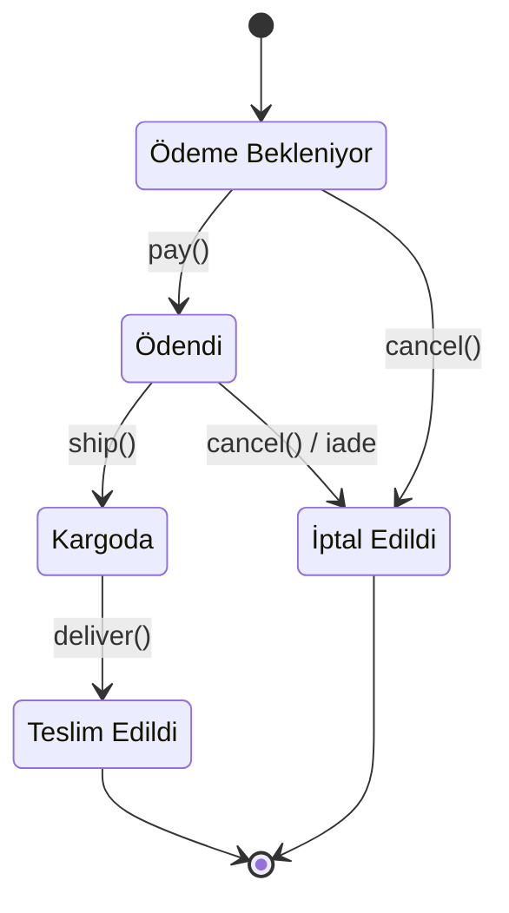
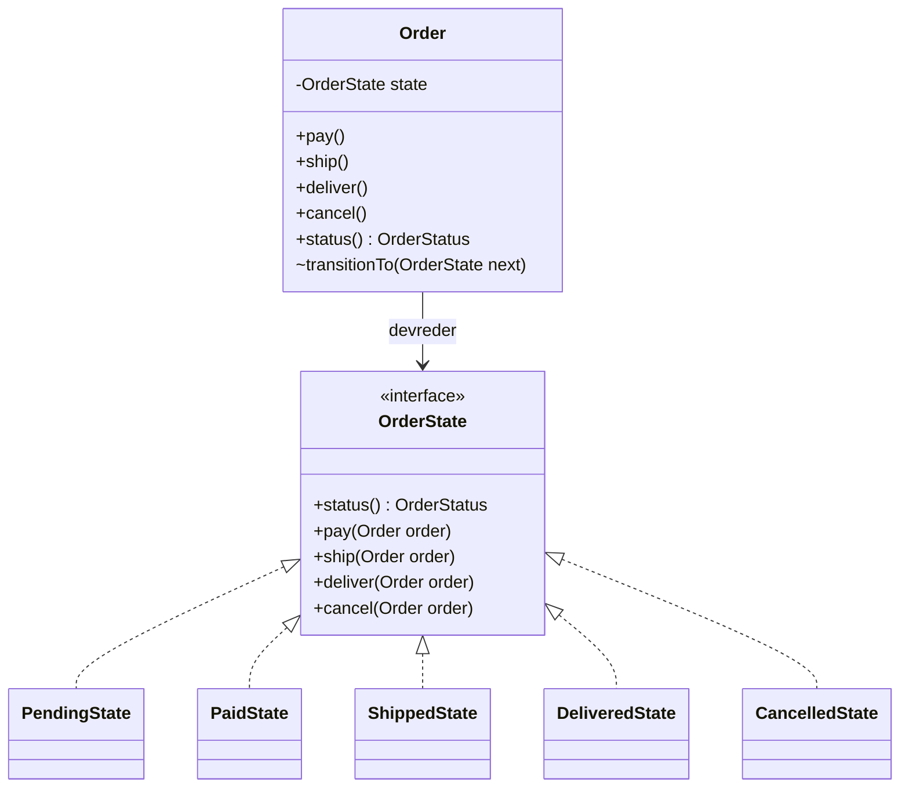

# Java'da State Tasarım Şablonu

### Nesnelerin hâlleri, davranışları ve değişimle barışık kod üzerine

> Kimlik sabittir; değişen, o anki hâldir. İyi tasarlanmış bir nesne de hangi hâlde olduğunu bilir ve ona göre davranır.

Bu yazıda State tasarım şablonunu Java ile, gerçekçi bir örnek üzerinden ele alıyorum. Derdim şablonun yalnızca nasıl yazıldığını göstermek değil; OOP, SOLID, temiz kod ve sürdürülebilirlik açısından **neden** böyle yazıldığını da konuşmak.

**Gereksinimler:** Java 17+ · Testler için JUnit 5

---

## İçindekiler

1. [Giriş: Bir Nesnenin Ruh Hali](#giriş-bir-nesnenin-ruh-hali)
2. [Problem: Her Metotta Aynı Soru](#problem-her-metotta-aynı-soru)
3. [State Şablonu Nedir](#state-şablonu-nedir)
4. [Adım Adım Uygulama](#adım-adım-uygulama)
5. [Test Edilebilirlik](#test-edilebilirlik)
6. [Durumu Kalıcı Hale Getirmek](#durumu-kalıcı-hale-getirmek)
7. [Yeni Bir Durum Eklemek](#yeni-bir-durum-eklemek)
8. [OOP ve SOLID Merceğinden](#oop-ve-solid-merceğinden)
9. [Geçişlere Kim Karar Vermeli](#geçişlere-kim-karar-vermeli)
10. [Hafif Alternatif: Enum ile State](#hafif-alternatif-enum-ile-state)
11. [State ile Strategy Arasındaki Fark](#state-ile-strategy-arasındaki-fark)
12. [Ne Zaman Kullanmalı, Ne Zaman Kullanmamalı](#ne-zaman-kullanmalı-ne-zaman-kullanmamalı)
13. [Sık Düşülen Tuzaklar](#sık-düşülen-tuzaklar)
14. [Son Söz](#son-söz)

---

## Giriş: Bir Nesnenin Ruh Hali

Sabah kahvesini henüz içmemiş biriyle, öğleden sonra keyfi yerine gelmiş aynı kişi arasında dağlar kadar fark vardır. Aynı soruyu sorarsınız, iki ayrı cevap alırsınız. Ama kimse "bunlar iki farklı insan" demez. Kişi aynıdır; değişen, o anki hâlidir.

Yazılımdaki nesneler de böyledir. Ödeme bekleyen bir sipariş iptal edilebilir, kargoya çıkmış olan edilemez. Durdurulmuş bir müzik çalar "oynat" komutuna başka, zaten çalarken başka tepki verir. Nesnenin kimliği sabittir; davranışı ise içinde bulunduğu duruma göre şekillenir.

State tasarım şablonu, bu gündelik gerçeği koda dökmenin en zarif yollarından biridir. Bu yazıda onu ezberlenecek bir kalıp olarak değil, bir düşünme biçimi olarak anlatmaya çalışacağım. Önce problemi hissedeceğiz, sonra çözümü adım adım kuracağız, en sonunda da sınırlarını dürüstçe konuşacağız.

---

## Problem: Her Metotta Aynı Soru

Bir e-ticaret sisteminde sipariş yönetimini düşünelim. Siparişin beş durumu var: **Ödeme Bekleniyor**, **Ödendi**, **Kargoda**, **Teslim Edildi** ve **İptal Edildi**. Kurallar ilk bakışta basit:

- Yalnızca ödeme bekleyen bir sipariş ödenebilir.
- Ödenmiş sipariş kargoya verilebilir, kargodaki sipariş teslim edilebilir.
- Ödeme bekleyen sipariş doğrudan, ödenmiş sipariş ise ücret iadesiyle birlikte iptal edilebilir.
- Yola çıkmış bir sipariş iptal edilemez.

Çoğumuzun ilk refleksi bir `enum` ve birkaç `switch` olur:

```java
public class Order {

    private OrderStatus status = OrderStatus.PENDING;

    public void pay() {
        switch (status) {
            case PENDING -> status = OrderStatus.PAID;
            case PAID -> throw new IllegalStateException("Sipariş zaten ödenmiş.");
            case SHIPPED, DELIVERED -> throw new IllegalStateException("Gönderilmiş sipariş ödenemez.");
            case CANCELLED -> throw new IllegalStateException("İptal edilmiş sipariş ödenemez.");
        }
    }

    public void cancel() {
        switch (status) {
            case PENDING -> status = OrderStatus.CANCELLED;
            case PAID -> {
                refundPayment();
                status = OrderStatus.CANCELLED;
            }
            case SHIPPED, DELIVERED -> throw new IllegalStateException("Yola çıkmış sipariş iptal edilemez.");
            case CANCELLED -> throw new IllegalStateException("Sipariş zaten iptal edilmiş.");
        }
    }

    // ship() ve deliver() için aynı switch'ler...
    // ve ileride eklenecek her metot için yine aynı switch.
}
```

İlk gün bu kod gayet masum görünür. Sorunlar zamanla ortaya çıkar:

- **Bilgi dağılır.** "Ödendi" durumundaki bir siparişin neler yapabileceğini öğrenmek için sınıftaki bütün metotları tek tek okumanız gerekir. Bir durumun kuralları tek bir yerde değil, dört ayrı `switch` içine serpiştirilmiştir.
- **Her değişiklik her yere dokunur.** Yeni bir durum eklediğinizde bütün `switch` bloklarını bulup güncellemeniz gerekir. Birini unutmak, üretim ortamında ortaya çıkan bir hata demektir.
- **Sınıf şişer.** `Order` hem verinin taşıyıcısı hem de bütün iş akışının beyni olur. Tek Sorumluluk İlkesi sessizce çiğnenir.
- **Test etmek zorlaşır.** Her metot, beş dalı olan küçük bir labirenttir.

### Aynı Tabloyu Farklı Yönden Kesmek

Aslında bu iş kurallarının tamamı tek bir tabloya sığar:

| Durum ↓ / İşlem → | `pay()` | `ship()` | `deliver()` | `cancel()` |
|---|---|---|---|---|
| **Ödeme Bekleniyor** | Ödendi | ✗ | ✗ | İptal Edildi |
| **Ödendi** | ✗ | Kargoda | ✗ | İade + İptal Edildi |
| **Kargoda** | ✗ | ✗ | Teslim Edildi | ✗ |
| **Teslim Edildi** | ✗ | ✗ | ✗ | ✗ |
| **İptal Edildi** | ✗ | ✗ | ✗ | ✗ |

<sub>✗: İşlem reddedilir. Diğer hücreler, işlemin siparişi taşıdığı yeni durumu gösterir.</sub>

Bu tablo bana iki şey söylüyor.

Birincisi, `switch`'li kod bu tabloyu **sütunlarından** keser: Her metot bir sütundur ve beş durumun hepsini bilmek zorundadır. State şablonu ise tabloyu **satırlarından** keser: Her sınıf bir satırdır ve yalnızca kendi durumunu bilir. Hangisinin doğru olduğu, sisteminizin hangi yönde büyüdüğüne bağlıdır. Durumlar çoğalıyorsa satırlara bölmek kazandırır, işlemler çoğalıyorsa sütunlara. Bilgisayar bilimlerinde bu ikilemin bir adı da var: *Expression Problem*. Bir şablonu ezberlemekle onu anlamak arasındaki fark, işte bu farkındalıktır.

İkincisi, tablonun büyük kısmı ✗ ile dolu. Yani bu sistemde asıl iş, izin vermekten çok **reddetmek**. Bu gözlemi birazdan tasarımımızın temeline koyacağız.

---

## State Şablonu Nedir

Gang of Four'un tanımını kendi cümlelerimle özetlersem: **State şablonu, bir nesnenin iç durumu değiştiğinde davranışının da değişmesine izin verir; dışarıdan bakan biri için nesne sanki sınıfını değiştirmiş gibi görünür.**

Fikrin özü tek cümleye sığar: **Koşulu nesneye dönüştür.** "Şu an hangi durumdayım?" sorusunu her metotta yeniden sormak yerine, her durumu kendi sınıfına taşırız. Asıl nesne gelen isteği o an elinde tuttuğu durum nesnesine devreder; durum değiştiğinde ise elindeki nesneyi değiştirir. Böylece `if` ve `switch` blokları çok biçimliliğe (polymorphism) dönüşür.

| Rol | Görevi | Örneğimizde |
|---|---|---|
| **Context** | Dış dünyanın konuştuğu nesne. Güncel durumu tutar ve istekleri ona devreder. | `Order` |
| **State** | Bütün durumların ortak sözleşmesi. Hangi işlemlerin istenebileceğini tanımlar. | `OrderState` |
| **Concrete State** | Belirli bir durumun davranışı ve o durumdan hangi durumlara geçilebileceği. | `PendingState`, `PaidState`, ... |

Siparişimizin yaşam döngüsü şöyle görünüyor:



Sınıflar arasındaki ilişki ise şöyle:



---

## Adım Adım Uygulama

### Proje Yapısı

```text
src/
├── main/java/com/ornek/
│   ├── Main.java
│   └── siparis/
│       ├── Order.java                            # Context: dış dünyanın tek kapısı
│       ├── OrderStatus.java                      # Durumun kalıcı ve okunabilir kimliği
│       ├── OrderState.java                       # State sözleşmesi (paket içi)
│       ├── OrderStates.java                      # Kayıtlı durumdan nesne üreten fabrika
│       ├── IllegalStateTransitionException.java
│       ├── PendingState.java
│       ├── PaidState.java
│       ├── ShippedState.java
│       ├── DeliveredState.java
│       └── CancelledState.java
└── test/java/com/ornek/siparis/
    └── OrderTest.java
```

Durum sınıflarının hepsini `Order` ile aynı pakete ve **paket içi (package-private)** görünürlükle koyduğuma dikkat edin. Bu bilinçli bir tercih; nedenini birazdan göreceğiz.

### 1. Durumun Kimliği: `OrderStatus`

```java
package com.ornek.siparis;

public enum OrderStatus {

    PENDING("Ödeme Bekleniyor"),
    PAID("Ödendi"),
    SHIPPED("Kargoda"),
    DELIVERED("Teslim Edildi"),
    CANCELLED("İptal Edildi");

    private final String label;

    OrderStatus(String label) {
        this.label = label;
    }

    public String label() {
        return label;
    }
}
```

Bu enum bilerek davranış taşımıyor. Görevi durumun **kimliğini** temsil etmek: veritabanına yazılacak, ekranda gösterilecek, raporlarda gruplanacak değer budur. Davranış ise birazdan yazacağımız durum sınıflarında yaşayacak. Kimliği davranıştan ayırmak, kalıcılık konusunu konuşurken işimizi çok kolaylaştıracak.

### 2. Sözleşme: `OrderState`

```java
package com.ornek.siparis;

/**
 * Bir siparişin yaşam döngüsündeki tek bir durumu temsil eder.
 *
 * <p>Sözleşme: Durum, kendisinde geçerli olmayan bir işlem istendiğinde
 * {@link IllegalStateTransitionException} fırlatır. Geçerli bir işlemde ise
 * siparişi bir sonraki duruma taşımaktan kendisi sorumludur.
 */
interface OrderState {

    OrderStatus status();

    default void pay(Order order) {
        throw rejected("ödeme");
    }

    default void ship(Order order) {
        throw rejected("kargoya verme");
    }

    default void deliver(Order order) {
        throw rejected("teslim");
    }

    default void cancel(Order order) {
        throw rejected("iptal");
    }

    private IllegalStateTransitionException rejected(String action) {
        return new IllegalStateTransitionException(status(), action);
    }
}
```

Bu arayüz küçük ama içinde üç önemli karar saklı:

- **Varsayılan cevap "hayır".** Tablodaki ✗ yoğunluğunu hatırlayın. Her işlem varsayılan olarak reddedilir; her durum yalnızca **izin verdiği** işlemleri yazar. Bir durum sınıfı yazarken "neyi yasaklamayı unuttum?" diye değil, "neye izin veriyorum?" diye düşünürsünüz. Güvenlikteki "varsayılan olarak kapalı" ilkesinin tasarımdaki karşılığı budur.
- **Durum, `Order`'ı parametre olarak alır.** Durum nesneleri sipariş referansını alan olarak saklamaz. Böylece hiçbir iç durumları olmaz, basit ve öngörülebilir kalırlar.
- **Arayüz paket içidir.** Dış dünya `OrderState` diye bir şeyin varlığından haberdar bile değildir. State şablonu bir uygulama detayıdır; istemcinin bilmesi gereken tek şey `Order`'dır.

### 3. Anlamlı Bir Hata: `IllegalStateTransitionException`

```java
package com.ornek.siparis;

public class IllegalStateTransitionException extends IllegalStateException {

    public IllegalStateTransitionException(OrderStatus status, String action) {
        super("'%s' durumundaki siparişte '%s' işlemi yapılamaz."
                .formatted(status.label(), action));
    }
}
```

`IllegalStateException`'dan türetmek anlamsal olarak doğru olanı yapmaktır: Nesne, istenen işlem için uygun durumda değildir. Üstelik genel `IllegalStateException` yakalayan mevcut kodlar da çalışmaya devam eder. Hatanın kendi türünün olması ise istemcinin bu durumu diğer hatalardan ayırt etmesini sağlar.

### 4. Context: `Order`

```java
package com.ornek.siparis;

import java.util.ArrayList;
import java.util.List;
import java.util.Objects;

public final class Order {

    private final String id;
    private final List<String> history = new ArrayList<>();
    private OrderState state;

    public Order(String id) {
        this(id, new PendingState());
        recordEvent("Sipariş oluşturuldu: " + state.status().label());
    }

    private Order(String id, OrderState initialState) {
        this.id = Objects.requireNonNull(id, "Sipariş kimliği boş olamaz");
        this.state = Objects.requireNonNull(initialState, "Başlangıç durumu boş olamaz");
    }

    public void pay() {
        state.pay(this);
    }

    public void ship() {
        state.ship(this);
    }

    public void deliver() {
        state.deliver(this);
    }

    public void cancel() {
        state.cancel(this);
    }

    public String id() {
        return id;
    }

    public OrderStatus status() {
        return state.status();
    }

    public List<String> history() {
        return List.copyOf(history);
    }

    // Yalnızca aynı paketteki durum sınıflarının kullanabildiği kapılar.

    void transitionTo(OrderState next) {
        OrderStatus previous = state.status();
        state = Objects.requireNonNull(next, "Yeni durum boş olamaz");
        recordEvent(previous.label() + " → " + next.status().label());
    }

    void recordEvent(String event) {
        history.add(event);
    }
}
```

Bu sınıfta beni en çok mutlu eden şey, public metotlarda **tek bir `if` olmaması**. `Order` artık neyin yapılacağına karar vermiyor; kime sorulacağını biliyor. Diğer ayrıntılar da tesadüf değil:

- **`transitionTo` paket içi.** Dış dünya `order.setState(...)` diyerek kuralların etrafından dolaşamaz. Geçişi yalnızca kuralı bilen durum sınıfları yapabilir. Kapsülleme burada gerçek anlamını buluyor: Sadece veriyi değil, **kuralları** da korumak.
- **Bütün geçişler tek kapıdan geçiyor.** Loglama, denetim kaydı ya da alan olayı (domain event) yayınlamak gibi kesişen ihtiyaçlar tek bir noktada çözülür.
- **`history()` kopya döner.** İç listeyi dışarı vermek, kapıyı aralık bırakmaktır.
- **İkinci kurucu `private`.** Neden var olduğunu kalıcılık bölümünde göreceğiz.

### 5. Somut Durumlar

```java
package com.ornek.siparis;

final class PendingState implements OrderState {

    @Override
    public OrderStatus status() {
        return OrderStatus.PENDING;
    }

    @Override
    public void pay(Order order) {
        order.transitionTo(new PaidState());
    }

    @Override
    public void cancel(Order order) {
        order.transitionTo(new CancelledState());
    }
}
```

```java
package com.ornek.siparis;

final class PaidState implements OrderState {

    @Override
    public OrderStatus status() {
        return OrderStatus.PAID;
    }

    @Override
    public void ship(Order order) {
        order.transitionTo(new ShippedState());
    }

    @Override
    public void cancel(Order order) {
        order.recordEvent("Ödeme iadesi başlatıldı");
        order.transitionTo(new CancelledState());
    }
}
```

```java
package com.ornek.siparis;

final class ShippedState implements OrderState {

    @Override
    public OrderStatus status() {
        return OrderStatus.SHIPPED;
    }

    @Override
    public void deliver(Order order) {
        order.transitionTo(new DeliveredState());
    }
}
```

```java
package com.ornek.siparis;

final class DeliveredState implements OrderState {

    @Override
    public OrderStatus status() {
        return OrderStatus.DELIVERED;
    }
}
```

```java
package com.ornek.siparis;

final class CancelledState implements OrderState {

    @Override
    public OrderStatus status() {
        return OrderStatus.CANCELLED;
    }
}
```

`PaidState` sınıfını açan biri, ödenmiş bir siparişin kaderini tek bakışta görür: Kargoya verilebilir ya da iadeyle iptal edilebilir, gerisi yasaktır. Başka hiçbir dosyaya bakmasına gerek yoktur. Bence iyi kodun en güzel hâli budur: Okuyana "başka nereye bakmam lazım?" diye sordurmamak.

`cancel()` metodunun üç farklı anlama geldiğine de dikkat edin. Ödeme bekleyen siparişte doğrudan iptal, ödenmiş siparişte iadeli iptal, kargodaki siparişte ise ret. Aynı mesaj, farklı hâl, farklı anlam. Ve bunu tek bir koşul ifadesi yazmadan başardık.

`DeliveredState` ve `CancelledState` sınıflarının neredeyse boş olması bir eksiklik değil, bir bilgidir: Bunlar yolun sonu (terminal state). Kod, iş kuralını kendi şekliyle anlatıyor.

> [!TIP]
> Durum sınıflarımız hiçbir alan taşımıyor. Bu yüzden her geçişte `new` ile yeni nesne üretmek yerine tek bir örneği paylaşmak da güvenlidir. Ben okunabilirliği öne çıkardım, çünkü bu kadar küçük nesneleri üretmenin maliyeti burada ihmal edilebilir. Gerçekten gerekirse durumları `static final` sabitler olarak tutabilirsiniz.

### 6. Kullanım ve Çıktı

```java
package com.ornek;

import com.ornek.siparis.IllegalStateTransitionException;
import com.ornek.siparis.Order;

public class Main {

    public static void main(String[] args) {
        Order order = new Order("SP-1024");

        order.pay();
        order.ship();

        try {
            order.cancel();
        } catch (IllegalStateTransitionException e) {
            System.out.println("Uyarı: " + e.getMessage());
        }

        order.deliver();

        System.out.println("Güncel durum: " + order.status().label());
        order.history().forEach(event -> System.out.println("  • " + event));
    }
}
```

```text
Uyarı: 'Kargoda' durumundaki siparişte 'iptal' işlemi yapılamaz.
Güncel durum: Teslim Edildi
  • Sipariş oluşturuldu: Ödeme Bekleniyor
  • Ödeme Bekleniyor → Ödendi
  • Ödendi → Kargoda
  • Kargoda → Teslim Edildi
```

İstemci kodunda tek bir durum kontrolü yok. İstemci siparişin içinde neler döndüğünü bilmiyor, bilmesine de gerek yok. Kendiniz denemek isterseniz:

```bash
javac -d out $(find src/main/java -name "*.java")
java -cp out com.ornek.Main
```

---

## Test Edilebilirlik

Kuralları satırlara böldüğümüzde testler de kendiliğinden sadeleşir. Her iş kuralı küçük, tek amaçlı bir teste karşılık gelir ve test dosyası neredeyse bir şartname gibi okunur:

```java
package com.ornek.siparis;

import static org.junit.jupiter.api.Assertions.assertEquals;
import static org.junit.jupiter.api.Assertions.assertThrows;
import static org.junit.jupiter.api.Assertions.assertTrue;

import org.junit.jupiter.api.BeforeEach;
import org.junit.jupiter.api.DisplayName;
import org.junit.jupiter.api.Test;

class OrderTest {

    private Order order;

    @BeforeEach
    void setUp() {
        order = new Order("SP-1");
    }

    @Test
    @DisplayName("Yeni sipariş ödeme bekler")
    void newOrderStartsAsPending() {
        assertEquals(OrderStatus.PENDING, order.status());
    }

    @Test
    @DisplayName("Mutlu yol: ödeme, kargo, teslim")
    void happyPathEndsWithDelivery() {
        order.pay();
        order.ship();
        order.deliver();

        assertEquals(OrderStatus.DELIVERED, order.status());
    }

    @Test
    @DisplayName("Ödenmiş sipariş iptal edilince iade başlatılır")
    void cancellingPaidOrderStartsRefund() {
        order.pay();
        order.cancel();

        assertEquals(OrderStatus.CANCELLED, order.status());
        assertTrue(order.history().contains("Ödeme iadesi başlatıldı"));
    }

    @Test
    @DisplayName("Kargodaki sipariş iptal edilemez ve durumu korunur")
    void shippedOrderCannotBeCancelled() {
        order.pay();
        order.ship();

        assertThrows(IllegalStateTransitionException.class, order::cancel);
        assertEquals(OrderStatus.SHIPPED, order.status());
    }
}
```

Son testteki ikinci doğrulama küçük ama önemli: Reddedilen bir işlem, nesneyi yarı yolda bırakmamalı. Durumlar geçersiz bir istekte hiçbir şeye dokunmadan hata fırlattığı için `Order` her zaman tutarlı bir hâlde kalır.

---

## Durumu Kalıcı Hale Getirmek

Teoride her şey güzel, ama gerçek bir uygulamada sipariş veritabanına yazılır ve ertesi gün geri okunur. `PaidState` gibi bir nesneyi veritabanına koyamayız. İşte `OrderStatus` enum'u burada devreye giriyor: Veritabanına durumun **kimliğini** yazarız, okurken **davranışı** bu kimlikten yeniden kurarız.

```java
package com.ornek.siparis;

final class OrderStates {

    private OrderStates() {
    }

    static OrderState of(OrderStatus status) {
        return switch (status) {
            case PENDING -> new PendingState();
            case PAID -> new PaidState();
            case SHIPPED -> new ShippedState();
            case DELIVERED -> new DeliveredState();
            case CANCELLED -> new CancelledState();
        };
    }
}
```

`Order` sınıfına da kayıtlı bir siparişi geri yüklemek için küçük bir fabrika metodu ekliyoruz. Gizli tuttuğumuz ikinci kurucu tam olarak bunun içindi:

```java
public static Order restore(String id, OrderStatus status) {
    return new Order(id, OrderStates.of(status));
}
```

Evet, bir `switch` geri döndü. Ama bu, kaçtığımız `switch`'lerden çok farklı: Tek bir yerde duruyor, yalnızca nesne üretiyor ve hiçbir iş kuralı taşımıyor. Robert C. Martin'in *Clean Code*'da söylediğine benzer bir yaklaşım bu: `switch`'e tahammül edilebilecek yer, onu bir fabrikanın içine gömüp dışarıya çok biçimli nesneler verdiğiniz yerdir. Üstelik bu bir *switch ifadesi* olduğu için enum'a yeni bir sabit eklenip `case` unutulduğunda kod derlenmez. Hatırlama işini derleyiciye devretmiş oluruz.

> [!NOTE]
> JPA gibi bir ORM kullanıyorsanız, entity'de yalnızca `OrderStatus` alanını `@Enumerated(EnumType.STRING)` ile saklayıp durum nesnesini ihtiyaç anında `OrderStates.of(status)` ile üretmek en sade yoldur. `ORDINAL` yerine `STRING` kullanın: Enum sabitlerinin sırası bir gün değişirse, `ORDINAL` ile saklanan veriniz sessizce anlam değiştirir.

---

## Yeni Bir Durum Eklemek

Asıl sınav, yazılımın değiştiği gündür. Ürün ekibi şunu istesin: *"Müşteriler teslim aldıkları siparişler için iade talebi oluşturabilsin."* Bu hem yeni bir işlem (`requestReturn`) hem de yeni bir durum (İade Talep Edildi) demek.

```java
// OrderStatus.java: yeni kimlik
RETURN_REQUESTED("İade Talep Edildi");

// OrderState.java: yeni işlem, varsayılan cevabı yine "hayır"
default void requestReturn(Order order) {
    throw rejected("iade talebi");
}

// Order.java: dış dünyaya açılan yeni kapı
public void requestReturn() {
    state.requestReturn(this);
}

// DeliveredState.java: tek bir yeni izin
@Override
public void requestReturn(Order order) {
    order.transitionTo(new ReturnRequestedState());
}

// OrderStates.java: fabrikaya bir satır (unutursanız kod derlenmez)
case RETURN_REQUESTED -> new ReturnRequestedState();
```

```java
package com.ornek.siparis;

final class ReturnRequestedState implements OrderState {

    @Override
    public OrderStatus status() {
        return OrderStatus.RETURN_REQUESTED;
    }
}
```

Peki neler değişti, neler yerinde kaldı?

| Dosya | Değişiklik |
|---|---|
| `PendingState`, `PaidState`, `ShippedState`, `CancelledState` | Hiç dokunulmadı |
| `DeliveredState` | Tek bir metot eklendi |
| `OrderState`, `Order`, `OrderStatus`, `OrderStates` | Birkaç satırlık ekleme |
| `ReturnRequestedState` | Yepyeni sınıf |

Burada dürüst olmak gerekiyor: Açık/Kapalı İlkesi'ni (OCP) "hiçbir dosyaya dokunmamak" diye yorumlarsak hayal kırıklığına uğrarız. Gerçek hayatta OCP'nin vaadi şudur: **Değişiklik küçük, yerel ve öngörülebilir olur; çalışan ve test edilmiş davranışlar yerinde durur.** `switch`'li versiyonda aynı özellik için bütün metotları açıp tek tek ameliyat etmemiz gerekirdi.

Bir de güzel bir yan etki var: Java'nın `default` metotları sayesinde yeni bir **işlem** eklemek de ucuzladı. Expression Problem'in "işlem eklemek zordur" tarafını, varsayılan reddetme davranışı büyük ölçüde yumuşattı.

---

## OOP ve SOLID Merceğinden

### Nesne Yönelimli Tasarımın Temel Taşları

- **Soyutlama:** `Order`, durumlarla yalnızca `OrderState` sözleşmesi üzerinden konuşur; hangi somut sınıfla konuştuğunu bilmez.
- **Kapsülleme:** Somut durumlar dış dünyadan tamamen gizlidir. Geçiş yetkisi paket içinde saklıdır.
- **Çok biçimlilik:** `cancel()` çağrısı, durumuna göre üç farklı davranışa dönüşür.
- **Kalıtım yerine birleşim (composition):** `Order` bir durum *değildir*, bir duruma *sahiptir*. Davranışını kalıtımla değil, çalışma zamanında değiştirilebilen bir bileşenle kazanır. Nesne sınıfını değiştiremez, ama sahip olduğu durumu değiştirebilir.

### SOLID İlkeleri

| İlke | Bu tasarımdaki karşılığı |
|---|---|
| **S**ingle Responsibility | Her durum sınıfı yalnızca kendi durumunun kurallarından sorumlu. `Order` ise sadece koordinasyon yapıyor. |
| **O**pen/Closed | Yeni bir durum, yeni bir sınıf demek. Mevcut durumların gövdesine dokunulmuyor. |
| **L**iskov Substitution | `Order`, hangi durumda olduğunu bilmeden her `OrderState`'i aynı beklentiyle kullanıyor. |
| **I**nterface Segregation | `OrderState` yalnızca yaşam döngüsü işlemlerini içeriyor. Fiyatlama, raporlama gibi işler bu arayüze ait değil. |
| **D**ependency Inversion | `Order`, somut durumlara değil `OrderState` soyutlamasına bağlı. Somut sınıflar yalnızca geçiş anında ve fabrikada tanınıyor. |

Liskov konusunda bir parantez açmak istiyorum. Varsayılan olarak hata fırlatan metotlar bazılarına LSP ihlali gibi gelebilir; Java'da `List.of(...)` ile oluşturulan bir listeye `add` çağrısının `UnsupportedOperationException` fırlatması da benzer tartışmalara konu olur. Benim görüşüm şu: LSP, alt türlerin **sözleşmeye** sadık kalmasını ister. `OrderState`'in sözleşmesi, Javadoc'ta açıkça yazdığı gibi, "geçersiz işlemi reddederim" der. Hiçbir durum bu sözleşmenin dışına çıkmıyor. Yani burada reddetmek bir istisna değil, sözleşmenin ta kendisi. İşin sırrı, bu beklentiyi belgelemekte.

---

## Geçişlere Kim Karar Vermeli

Bizim uygulamamızda bir sonraki duruma **durumların kendisi** karar veriyor. Tek seçenek bu değil. Geçiş kuralları merkezi bir tabloda ya da `Context` içinde de tutulabilir:

| Ölçüt | Durumlar karar verir (bizim yaklaşım) | Merkezi geçiş tablosu |
|---|---|---|
| Kuralın yeri | İlgili durum sınıfının içinde | Tek bir tabloda ya da yapılandırmada |
| Kolay olan | Tek bir durumu derinlemesine anlamak | Bütün akışı tek bakışta görmek |
| Bağımlılık | Durumlar birbirini tanır | Durumlar birbirinden habersizdir |
| Uygun olduğu yer | Davranışın duruma göre zengin biçimde değiştiği alanlar | Çok sayıda durum, sık değişen akışlar, iş birimlerinin yönettiği süreçler |

Akış onlarca duruma ulaşmış, geçişlere koşullar (guard), zamanlayıcılar ve paralel bölgeler karışmaya başlamışsa elle yazılmış State şablonu yerine Spring Statemachine gibi olgun bir durum makinesi kütüphanesine bakmak gerekir. Tasarım şablonu bir başlangıç noktasıdır, bir kafes değil.

---

## Hafif Alternatif: Enum ile State

Durumlar az, sabit ve dış bağımlılık gerektirmiyorsa Java'nın enum'ları şablonun çok zarif, hafif bir sürümünü sunar. Her sabit, kendi davranışını kendi gövdesinde taşır:

```java
public enum TrafficLight {

    RED {
        @Override
        public TrafficLight next() {
            return GREEN;
        }
    },
    GREEN {
        @Override
        public TrafficLight next() {
            return YELLOW;
        }
    },
    YELLOW {
        @Override
        public TrafficLight next() {
            return RED;
        }
    };

    public abstract TrafficLight next();
}
```

Kullanımı da bir o kadar sade: `light = light.next();`. Burada durum değiştirilmiyor, bir sonraki durum **döndürülüyor**. Değişmezlik (immutability) bedavaya geliyor.

| Enum tabanlı State | Sınıf tabanlı State |
|---|---|
| Kısa ve tek dosyada | Her durum kendi dosyasında |
| Tekil, iş parçacığı güvenli, serileştirmesi kolay | Esnek ama bu garantileri kendiniz sağlarsınız |
| Bağımlılık enjekte etmek zahmetli | Servis ve bağımlılıklarla rahat çalışır |
| Yeni durum, enum'u değiştirmeyi gerektirir | Yeni durum, yeni bir sınıf demektir |
| **Trafik lambası, basit oyun durumları** | **Sipariş, ödeme, onay akışları** |

---

## State ile Strategy Arasındaki Fark

İki şablonun UML diyagramları neredeyse birebir aynıdır: Bir context, bir arayüz ve birkaç somut sınıf. Bu yüzden sık sık karıştırılırlar. Farkı yapıda değil, **niyette** aramak gerekir.

| Ölçüt | State | Strategy |
|---|---|---|
| Temel soru | "Şu an hangi hâldeyim?" | "Bu işi hangi yöntemle yapayım?" |
| Değişimi kim başlatır | Çoğunlukla durumların kendisi | Çoğunlukla istemci, dışarıdan |
| Somut sınıflar birbirini tanır mı | Evet, geçişler için tanırlar | Hayır, birbirinden habersizdir |
| Değişim sıklığı | Nesnenin ömrü boyunca defalarca | Genellikle bir kez seçilir |
| Tipik örnek | Sipariş akışı, TCP bağlantısı | Sıralama algoritması, ödeme yöntemi, sıkıştırma türü |

Benim aklımda kalan benzetme şu: Strategy, "İstanbul'a uçakla mı otobüsle mi gideyim?" sorusudur; seçimi siz yaparsınız. State ise "Yolculuğun neresindeyim?" sorusudur; cevabı yolculuğun kendisi belirler.

---

## Ne Zaman Kullanmalı, Ne Zaman Kullanmamalı

**State şablonu iyi bir seçimdir, eğer:**

- Aynı durum kontrolü birden fazla metotta tekrar ediyorsa,
- Nesnenin davranışı durumuna göre gerçekten farklılaşıyorsa (sadece bir etiket değişmiyorsa),
- Durumlar ve geçiş kuralları iş açısından kritikse (sipariş, ödeme, abonelik, onay akışları),
- Durum sayısının zamanla artması bekleniyorsa.

**Muhtemelen gereksizdir, eğer:**

- Durum yalnızca bir bilgi etiketiyse ve davranışı değiştirmiyorsa,
- İki üç durum ve tek bir yerde basit bir koşul varsa,
- Durumlar sabit ama işlemler sürekli artıyorsa,
- Akış o kadar karmaşıksa ki hazır bir durum makinesi kütüphanesi işi daha iyi görecekse.

**Gerçek hayattan tanıdık örnekler:**

1. **TCP bağlantısı:** Kapalı, dinliyor, bağlantı kurulmuş. Gang of Four kitabındaki klasik örnek.
2. **Medya oynatıcı:** Durdu, çalıyor, duraklatıldı.
3. **Belge yayın akışı:** Taslak, incelemede, yayında, arşivde.
4. **Otomat makinesi:** Para bekliyor, ürün seçiliyor, ürün veriliyor, stok yok.
5. **Oyun karakteri:** Ayakta, koşuyor, zıplıyor, yaralı.
6. **Kullanıcı hesabı:** Aktif, askıya alınmış, kilitli.

---

## Sık Düşülen Tuzaklar

1. **Durumu dışarıdan değiştirilebilir bırakmak.** `public void setState(...)` yazdığınız anda bütün kurallar tek satırla delinebilir hâle gelir. Geçiş yetkisi, kuralı bilenlere ait olmalıdır.
2. **Durum sınıflarına değişken alanlar koymak.** Siparişe ait veri (tutar, adres, tarih) `Context`'te yaşar. Durum sınıfı yalnızca kuralı taşır. Aksi hâlde paylaşılan durum nesneleri, bulunması zor hatalara kapı açar.
3. **Geçersiz işlemi sessizce yutmak.** Boş bırakılmış bir metot "hiçbir şey olmadı" der ama aslında bir hatayı gizler. Varsayılan tutum hızlı ve görünür biçimde başarısız olmaktır. Tek istisna, iş kuralının gerçekten etkisizlik istemesidir: Zaten çalan bir şarkıda "oynat"a basmak gibi. O zaman sessiz kalmak bir ihmal değil, bilinçli bir karardır.
4. **`Context`'i durumlara sonuna kadar açmak.** Durum sınıfları `Order`'ın her alanına erişebiliyorsa, kuralları yeniden dağıtmışsınız demektir. Durumlara yalnızca ihtiyaç duydukları dar bir yüzey sunun; bizim örneğimizde bu yüzey `transitionTo` ve `recordEvent`'ten ibaret.
5. **Durum sınıflarını iş mantığıyla şişirmek.** Durum, "ne zaman, neye izin verilir?" sorusunun cevabıdır. İadenin bankayla nasıl konuşacağı ise bir servisin işidir. Durum sınıfı orkestra şefidir; bütün enstrümanları kendisi çalmaz.
6. **Her şeye State uygulamak.** İki durumu ve tek bir `if`'i olan bir problemi beş sınıfa bölmek, sadeliği tasarım uğruna feda etmektir. Şablon bir araçtır, amaç değil.

---

## Son Söz

State şablonunu ilk öğrendiğimde bana biraz fazla tören gibi gelmişti. Beş durum için beş sınıf, bir arayüz, bir fabrika... Bir `switch` ile çözülecek iş için bu kadar zahmet mi? Zamanla şunu fark ettim: Bu şablonun kazandırdığı şey satır sayısı değil, bir düşünme biçimi. Kodu "hangi işlemi yapıyorum?" sorusu yerine "şu an neyim ve bu hâlde neler yapabilirim?" sorusu etrafında örgütlemek.

İyi tasarım geleceği tahmin etmek değil, değişime yer açmaktır. State şablonu bunu çok zarif biçimde yapar: Her durumu kendi odasına koyar, kapıları yalnızca anahtarı olanlara açar. Yeni bir durum geldiğinde evi yıkmazsınız, yeni bir oda eklersiniz.

Yazının başındaki insana dönelim. Kahvesini içmemiş o insanla keyfi yerinde olan, aynı insandır. `Order` da baştan sona aynı `Order`'dır. Değişen yalnızca hâlidir; biz de o hâle kendi sınıfını vermiş olduk.

> Kod da insan gibidir: Hangi hâlde olduğunu dürüstçe bilen, nasıl davranacağını da bilir.
